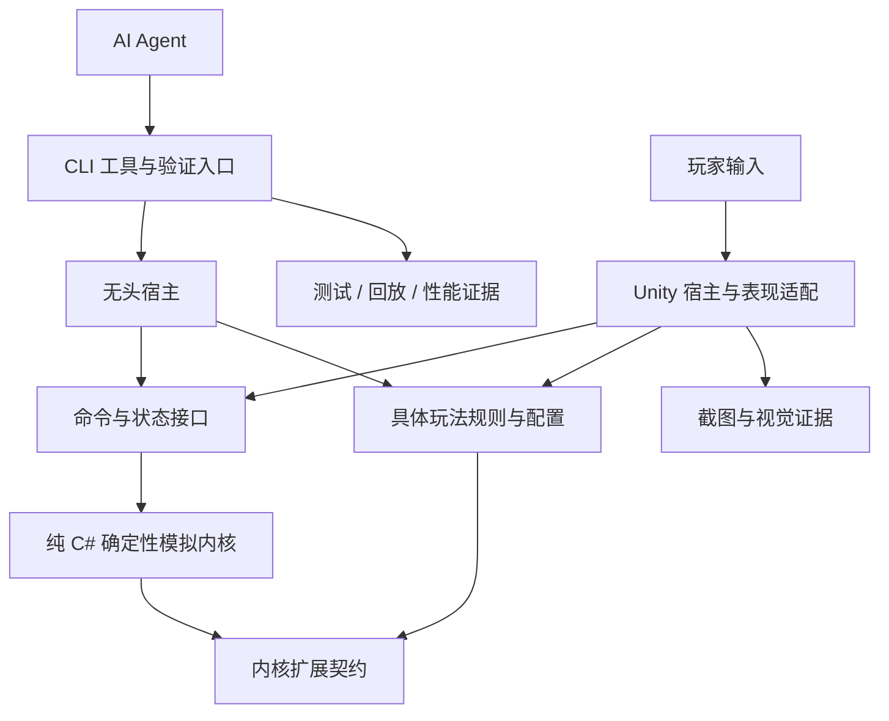

# AI Native 游戏引擎设计思路

> 状态：整体设计基线。第一阶段无头玩法闭环已实现并本地验证，详见[阶段实施与验收记录](phase-1-headless-gameplay-plan.md)。其余能力仍为建设目标。

具体实现遵循[架构与代码规范](engineering-guidelines.md)。该规范约束依赖方向、状态所有权、C# 风格及可读性；架构或契约调整时同步更新两份文档，避免实现与设计分离。

## 1. 目标与设计取舍

本项目要构建一套让 AI Agent 能观察、操作、复现和验证游戏的独立玩法内核与工具链。AI Native 的落点是稳定的工程接口、低成本的验证循环和可持续积累的项目知识。

首版采用 **纯 C# 模拟内核、Unity 首个表现层适配、单机网格回合制验证游戏**。先证明一条完整开发闭环，再扩大玩法和技术范围。

| 核心目标 | 设计要求 | 验证证据 |
| --- | --- | --- |
| 可观察 | 能查询结构化状态、事件、错误和性能信息 | Agent 无需猜测画面即可判断规则结果 |
| 可操作 | 状态变化有统一命令入口，推进过程显式可控 | 同一组命令可由玩家、测试或 Agent 提交 |
| 可复现 | 初始状态、命令、随机状态和版本可记录 | 相同条件下得到相同状态摘要 |
| 可验证 | 逻辑、视觉、性能分别有适合的验证方法 | 每次改动有对应证据，而非仅有完成声明 |
| 可接续 | 规则、决策、进度和复现案例保存在仓库 | 更换 Agent 或会话后可以继续任务 |

首版不建设自研渲染、物理、资源管线、通用编辑器、多人同步或体素系统。Unity 负责表现与资源接入；首版玩法不以 Unity 物理结果裁定权威状态。未来若需要物理参与规则，必须重新定义输入、确定性边界与验证方式。

不强制所有实体共用一个 Fat Struct，不提前建设完整 ECS/GAS，也不引入 Rust 跨语言边界。优先采用稳定实体标识和简单组合式数据模型，只有具体需求或性能证据足够时才增加抽象。

## 2. 核心架构

### 2.1 模块与依赖

下图箭头表示调用或依赖方向。玩法规则实现内核定义的扩展契约，由宿主装配；通用内核不引用具体游戏或 Unity。

| 模块 | 负责 | 边界 |
| --- | --- | --- |
| 玩法与配置 | 移动、攻击、胜负条件、单位定义、地图与数值 | 不控制 Unity 对象、进程或工具协议 |
| 模拟内核 | 实体标识、状态生命周期、逻辑步、命令调度、随机源、状态导出 | 不依赖 Unity、渲染、墙上时钟或网络 |
| 命令与状态接口 | 命令验证与执行结果、只读查询、快照与回放契约 | 不暴露可直接修改的内部对象引用 |
| 无头宿主 | 装配规则与配置、驱动模拟、支持批量验证 | 不重新实现玩法规则 |
| Unity 适配 | 输入转命令、读取状态和事件、播放动画与音效、更新 UI | 不独立扣血、扣资源或决定胜负 |
| 工具与验证层 | CLI、测试执行、回放比较、性能报告、证据归档 | 通过公开能力边界操作，不绕过命令直接改状态 |

命令与状态接口是逻辑边界，不要求首版拆成远程服务。CLI 的传输与进程细节由工具层承担，核心接口保持可在进程内调用。

### 2.2 玩法数据与状态

区分三类数据：

- **配置**：单位基础属性、攻击规则参数、地图定义等。使用外部数据文件、Schema 和版本标识；在开始模拟前校验，首版仅在场景重载时生效。
- **权威运行状态**：单位当前位置与生命值、当前回合、胜负结果、随机发生器状态等。由内核及装配的玩法规则统一维护。
- **表现状态**：动画进度、镜头插值、音效播放、UI 过渡等。Unity 自行维护，不写回权威状态。

实体之间使用稳定标识引用，不以 Unity 对象引用作为玩法数据。查询返回只读视图或数据副本。初期以完整状态和事件支持表现同步，只有测量发现必要时再增加增量状态协议。

运行中热更新留到后续阶段：届时必须明确配置变更对现存实体、快照兼容性与回放版本的影响，不能只实现文件重新读取。

### 2.3 命令、逻辑步与事件

玩家、测试和 Agent 共用同一命令模型。首个游戏的命令包括四方向移动、攻击和结束回合；加载场景与恢复快照是显式管理操作，不作为普通玩法命令混入回放。

一次逻辑步按以下顺序执行：

1. 宿主提交命令并取得接收结果；接收成功不等于玩法执行成功。
2. 显式推进时，按稳定顺序处理待执行命令，依据当前权威状态检查合法性。
3. 合法命令由玩法规则计算并提交状态变更，产生结果与事件；非法命令返回结构化原因，不改变玩法状态或消耗玩法随机数。
4. 返回逻辑步完成后的状态或摘要，宿主消费事件；动画播放不影响下一步规则计算。

正常运行期间的外部玩法变更只通过命令进入。由规则触发的伤害、回合转换与胜负判定，在同一次受控推进中完成。工具层不得另开修改内部字段的捷径。

首版移动以 Up（Y+1）、Down（Y-1）、Left（X-1）、Right（X+1）表示，规则层从执行时位置推导相邻目标格；不提供任意目标坐标移动。首版用顺序命令流，不预设网络重试和多人冲突协议。操作结果必须区分命令被拒绝、模拟失败和宿主故障，不能把失败伪装成成功的空结果。

### 2.4 确定性与复现边界

固定随机种子只是起点，还需约束以下条件：

| 影响来源 | 首版约束 |
| --- | --- |
| 随机性 | 使用显式、可保存恢复的随机源；记录算法版本及内部状态，禁止隐式随机调用 |
| 执行顺序 | 命令顺序、实体遍历和规则执行稳定，不依赖无序容器迭代或线程调度 |
| 时间 | 规则只依赖显式逻辑步和回合，不读取帧间隔或系统时间 |
| 数值 | 网格位置和首版战斗规则使用整数，避免以表现插值决定结果 |
| 外部输入 | 场景、配置、命令均作为明确输入，不在规则执行中读取变化中的外部资源 |
| 运行环境 | 记录支持的运行时与构建标识，不承诺任意平台或版本间自动一致 |

复现承诺限于相同规则、配置和支持环境。回放材料包含初始快照、命令顺序及推进位置、随机状态、规则版本、配置版本与内容标识，以及环境信息。配置版本需能解析到相应内容；只有一个无法恢复内容的版本字符串不足以复现。

快照在完整逻辑步边界生成。首版要求无待执行命令时保存；调用方先完成推进，避免遗漏队列导致恢复后分歧。快照包含全部权威状态、逻辑步、随机状态和兼容性信息，不包含表现对象。

状态摘要基于稳定排序和规范化表达，仅覆盖权威状态及影响后续计算的随机状态，排除日志时间、性能数据、动画进度等信息。摘要不一致时同时输出结构化状态差异，方便定位首个分歧。

加载与恢复先验证兼容性，通过后才替换当前状态。首版对不兼容的规则、配置或快照格式明确拒绝，不做静默迁移；规则升级后的历史回放验证需要显式建立新的兼容策略。

## 3. 面向 Agent 的最小能力接口

以下是能力契约，具体命令名称、字段和数值退出码在实现阶段确定。CLI 首先提供机器可读的结构化结果和明确的成功、校验失败、执行失败退出语义；日志与机器结果分离，避免 Agent 依赖日志措辞解析结果。

| 能力 | 输入类别 | 输出类别与责任 |
| --- | --- | --- |
| 加载场景 | 场景、规则与配置标识、初始种子 | 已验证的初始状态、版本信息或错误；宿主负责装配 |
| 提交命令 | 命令类型、目标实体、参数 | 接收标识或输入错误；最终执行结果在推进后取得 |
| 推进模拟 | 显式逻辑步数、待执行命令 | 执行结果、事件、最新状态摘要；内核负责规则计算 |
| 查询状态 | 查询范围、实体标识 | 只读结构化状态；不改变模拟 |
| 保存快照 | 当前模拟实例、输出目标 | 快照及版本信息；检查处于可保存边界 |
| 恢复快照 | 快照、对应规则与配置 | 恢复状态摘要或明确兼容性错误 |
| 执行回放 | 初始快照、命令与推进记录、预期检查点 | 逐检查点比较结果、首个分歧及复现材料 |
| 运行测试 | 测试范围、场景与参数 | 通过与失败统计、断言详情、证据位置 |
| 输出性能报告 | 固定场景、运行次数及环境 | 耗时、内存等结构化测量与环境信息 |
| 截图 | Unity 场景、逻辑检查点、固定视角与表现设置 | 图片及关联状态摘要；仅由 Unity 适配提供 |

首版 CLI 优先支持一次调用完成“加载、执行命令序列、验证、输出证据”的批处理。跨进程延续状态使用快照，避免把进程内状态误当成自动持久化。MCP 与常驻会话按后续交互需求增加，复用同一能力边界。

### 3.1 一次完整迭代的数据流

以“调整单位攻击力并验证胜负结果”为例：

1. 人定义期望行为和验收场景；Agent 读取规则、配置及相关测试。
2. 使用固定场景、种子和命令序列生成修改前基线，记录状态与性能证据。
3. Agent 修改配置，校验 Schema；重新加载场景使配置生效。
4. 无头宿主执行相同命令序列，检查伤害、生命值与胜负条件。
5. 新配置对应新的版本与基线。跨配置的前后比较属于受控实验，不能冒充相同版本下的回放一致性测试。
6. 必要时让 Unity 运行同一序列，在相同检查点截图，检查血条和表现是否符合状态。
7. 独立审查改动与证据，自动门禁通过后由人确认体验；保存新决策和复现入口。

### 3.2 验证方法

逻辑正确性以规则断言和状态差异为准。截图采用固定视角、固定分辨率与明确表现检查点，必要时隔离 UI、裁剪区域并生成图像差分，减少动态背景干扰。图像相似度只能辅助发现视觉变化，不能证明游戏逻辑正确或体验有趣。

性能比较使用相同环境和负载，记录预热、重复次数及统计方法。输出 Agent 可读的报告，保留原始结果；不把一次运行的速度变化直接解释为优化收益。具体工具选型在需要时验证，不将参考材料中提到的工具能力直接视为已验证事实。

## 4. Agent 工作流与项目知识

### 4.1 角色与交付顺序

**需求澄清 → 调研与计划 → 实现 → 独立审查 → 自动验证 → 人工体验验收 → 知识沉淀**。

实现过程中可以提前运行检查；独立审查后的最终改动必须通过自动验证。若审查引入新改动，重新执行受影响检查。

| 角色 | 职责 | 交付证据 |
| --- | --- | --- |
| 人 | 明确玩法意图、范围与取舍，处理架构决策，验收体验 | 目标、接受条件、决策结论 |
| 主 Agent | 收集上下文、形成计划、拆分边界、组织验证 | 任务卡、接口约定、集成结果 |
| 实现 Agent | 在约定范围内修改，运行相关验证 | 改动摘要、测试结果、复现入口 |
| 独立 Reviewer | 对照需求、边界和证据审查，识别遗漏和风险 | 问题清单与处理结论 |
| 自动门禁 | 执行编译、静态检查及相关测试 | 可重复执行的检查结果 |

写代码的 Agent 不承担最终独立审查。Reviewer 可以由另一 Agent 或人承担。并行仅用于边界明确、互不冲突且有实际收益的任务；涉及共享状态契约时先统一接口，再分派实现。并行任务使用独立工作区，集成后运行组合验证，不能仅拼接各自的通过声明。

### 4.2 任务与证据的最小模板

每项任务至少记录：

- 目标与动机，以及明确不处理的事项。
- 影响模块、依赖与必须遵循的架构边界。
- 可观察的验收条件、固定场景和复现入口。
- 实现与审查责任、尝试预算、需由人决定的事项。

交付至少记录：改动摘要、执行过的检查及结果、关联版本、必要的状态或视觉差分、未解决问题。不能将未执行检查写成通过，也不能仅凭编译成功关闭玩法任务。

默认同一失败允许三轮“假设、修改、验证”；每轮保存证据并缩小问题范围。预算用尽、无法复现、需要改变架构边界或验收目标时，由人决定下一步。失败材料至少包含场景、版本、命令序列、预期与实际结果；日志仅作为补充，避免大量无关内容污染上下文。

### 4.3 仓库知识与门禁

未来 `.spec/` 用于保存项目规则、架构决策、任务状态与复现案例索引，具体代码和配置仍是实现事实来源。稳定设计放在文档，任务只引用相关片段与证据，避免复制多份相互冲突的规范。当前只保留实际需要的源代码、文档和基础验证配置，不创建空的知识目录体系。

每次工作结束，把已经验证的经验沉淀为规则、决策或回归案例，注明适用范围和变更原因。假设与待查信息必须明确标注，不能进入规范后被误认作事实。二进制截图等大型证据可存放在后续 CI 制品中，仓库保留可定位的索引与复现方式。

验证按层运行：

1. 编译与静态检查：发现类型、依赖和基本质量问题。
2. 无头逻辑测试：覆盖规则、非法输入和状态不变量。
3. 确定性回放：检查重复执行及快照恢复的连续性。
4. Unity 集成与视觉检查：验证输入映射、状态呈现和关键画面。
5. 人工体验验收：确认目标玩法和反馈符合预期。

根据影响范围选择检查层级，公共契约变化要覆盖所有相关宿主。测试通过是交付必要条件，不能替代需求与体验验收。初期使用命令行和仓库文件完成闭环；工单平台、外部项目管理和自动发布是后续独立集成，不是首版前置依赖。

## 5. 落地顺序

阶段按证据推进，不预先承诺工期。阶段 0 的文档完成只代表设计基线建立，不代表实现或行为验证已经通过。

| 阶段 | 建设内容 | 退出条件 |
| --- | --- | --- |
| 0：设计基线 | 模块边界、最小接口、验证场景与任务规则 | 每项核心能力都有责任模块和验证方式，范围与接口无矛盾 |
| 1：无头玩法闭环 | 整数网格、移动、攻击、回合和胜负、确定性随机源 | 不启动 Unity 可完成一局；非法命令不修改玩法状态 |
| 2：复现与 Agent 工具 | CLI、查询、快照、回放、摘要与版本检查 | 同条件重复执行一致；保存恢复后连续运行一致；不兼容输入明确拒绝 |
| 3：Unity 表现适配 | 输入转命令、状态呈现、动画、截图 | 两种宿主执行相同命令序列得到一致核心状态，表现速度不改变规则结果 |
| 4：Agent 交付闭环 | 任务模板、独立审查、CI 门禁与证据归档 | 数值调整、规则变更、Bug 修复各完成一次完整交付，均有可复现证据 |
| 5：扩展决策 | 实时模拟、联网、体素、ECS/GAS、Rust 的按需评估 | 每项扩展有产品需求或性能测量支持，独立形成设计与验收条件 |

首个验证游戏采用固定小型网格、双方单位和障碍物，支持移动、攻击、结束回合和胜负判定。重点验证规则边界与开发闭环；美术用最小占位资源，复杂寻路、技能树和内容生产不进入首轮。

扩展的启动依据如下：

- 实时模拟：产品确实需要持续时间推进，先明确步长与输入采样语义。
- 多人联网：已有单机权威状态与回放基础，再设计服务器裁决、同步及断线策略。
- 体素：产品需要可编辑空间，先验证世界数据量与修改语义。
- ECS/GAS：当前组合模型在具体实体规模或技能需求下出现可测的维护与执行瓶颈。
- Rust：剖析证实 C# 热点无法通过更简单的局部改进解决，再评估互操作和维护成本。

## 6. 验收场景与收益测量

以下是各阶段实现必须验证的行为；已完成项与测试证据见阶段验收记录，快照、回放工具及 Unity 相关项目仍待后续实施。

| 场景 | 预期结果 |
| --- | --- |
| 无头完成一局 | 固定输入序列产生预期胜负，运行不依赖 Unity |
| 非法移动或攻击 | 越界、阻挡、无效目标或回合不合法时明确拒绝，不变更玩法状态与随机状态 |
| 重复执行 | 相同场景、版本、种子和命令序列在各检查点产生相同摘要 |
| 存读档连续性 | 执行前半段、保存、恢复、继续，与不中断执行的最终状态和随机状态一致 |
| 版本不匹配 | 不兼容的规则、配置或快照格式在替换当前状态前被拒绝 |
| 查询无副作用 | 查询前后权威状态摘要一致，返回数据不能成为外部修改通道 |
| 回放分歧 | 修改一个输入后能报告首个分歧及字段级差异，不只返回失败布尔值 |
| 宿主一致性 | 无头和 Unity 使用相同规则及输入时得到一致权威状态 |
| 表现独立性 | 改变动画速度、渲染帧率或关闭音效不改变玩法结果 |
| 配置应用 | 不合法配置加载失败；合法新配置仅在重载场景后生效 |
| CLI 失败语义 | 错误输入和执行故障返回明确失败结果，机器输出不混入非结构化日志 |
| Agent 交付 | 数值、规则、Bug 三类任务均经过独立审查和相关检查，证据能重新生成 |

记录构建耗时、测试耗时、问题复现时间和人工介入次数，按同类任务和固定环境比较。另记录性能场景的运行耗时与内存，以及证据不足或回放失败的原因。首次测量用于建立基线，之后才设定合理改进目标。

不将 Token 消耗、代码行数或并行 Agent 数作为生产力目标；不承诺“十倍加速”或百人在线。测量重点是达到可验收结果的成本，以及结果能否可靠复现。

## 7. 参考来源与采用边界

1. [《你的游戏本身就是脚手架：如何让 AI Agent 读懂游戏并十倍加速迭代？》](https://zhuanlan.zhihu.com/p/2094179592684816169)：提供可复现状态、命令、无头模拟、外部化配置与反馈闭环的思路。本文将这些作为设计原则；单一 Fat Struct、具体工具能力与性能数字不直接照搬。
2. [LumioGames GitHub 主页](https://github.com/LumioGames)及其[主页 README](https://github.com/LumioGames/.github/blob/main/profile/README.md)：提供分层架构、Agent 分工、独立审查和仓库知识沉淀的参考。本项目首版不采用其多人在线体素范围或 Rust/C# 双层实现路线。

上述材料是设计参考，不据此推断二者存在实现关系或来源关系。外部项目主页中的愿景与阶段性测试不等于本仓库的能力证明。本文技术能力均需按阶段实现并取得验收证据，不能从第一阶段验证推断其余能力已完成。
