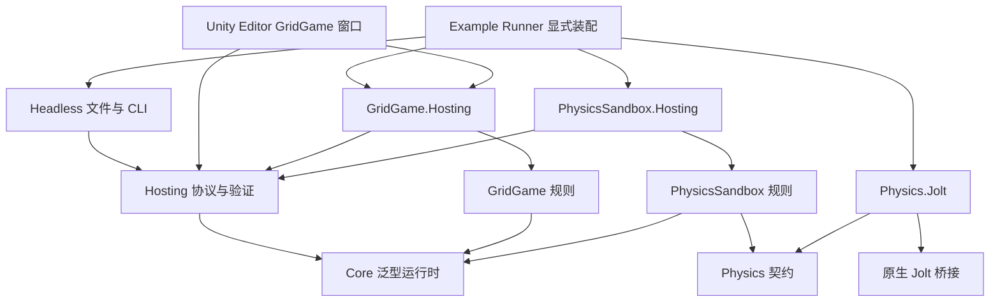

# AI Native 游戏引擎设计思路

当前设计基线为通用框架 v2，详细签名、协议和物理边界见 [v2 契约](framework-v2.md)，实际验证见 [v2 验收](v2-acceptance.md)。第一、第二阶段与原宿主边界文档是历史证据。第三阶段首个宿主已接入 GridGame，记录见 [Unity Editor 验收](phase-3-grid-editor.md)。PhysicsSandbox 的 Unity 集成、Player 和 IL2CPP 仍待实施。

实现同时遵循[架构与代码规范](engineering-guidelines.md)。边界变化必须同步契约、验证与验收说明。

## 1. 目标与取舍

工程为不同类型游戏提供可观察、可操作、可复现、可验证的玩法内核与工具链。通用性来自明确的游戏实现与宿主装配边界，不把网格、攻击、回合或刚体强加给所有游戏。GridGame 和 PhysicsSandbox 分别验证手动回合制与固定频率实时物理。

Core 保持纯 C#，不依赖 Unity、文件、网络、JSON、物理实现或任何 Example。物理属于可选能力，由需要它的游戏显式调用。当前不建设资源、UI、音频框架、通用 ECS、系统调度框架、网络同步或插件发现。

新增 Hosting 是为了让两个游戏共享协议、记录和表现辅助；新增 Physics 是为了隔离游戏规则与原生实现；保留专属协议适配是为了让共享库不认识游戏字段。可移植库保持 netstandard2.1/C# 9，工具使用 .NET 10。

## 2. 架构与所有权

游戏模块创建/恢复完整运行时，宿主不自行配对会话和规则。运行时独占游戏实例，物理示例独占物理世界。Dispose 幂等，释放后操作失败；候选恢复完全验证后才可替换旧对局。没有跨对局的可变玩法静态状态；Jolt 全局类型注册仅由原生世界引用计数管理。

### 2.1 时间、输入与故障

输入序号、已处理输入数、模拟 Tick、玩法回合相互独立。Submit 只排队。Advance 按序消费调用开始时全部输入，然后调用游戏推进一次，再发布绑定 Tick 的不可变观察、有序输入结果和事件。空输入也推进；调用期间不可重入。Core 不读系统时间。

时间设置在创建时固定并进入记录。GridGame 的手动模式步长为零，回合由 EndTurn 规则决定；PhysicsSandbox 为 60 Hz。物理规则明确执行输入/物理前规则 → 一次 Jolt 更新 → 已排序碰撞消费/物理后规则。当前只做最小示例，没有额外系统调度抽象。

业务拒绝不修改该输入的状态、不消耗随机数，后续输入与物理仍执行。意外异常使运行时进入故障状态，不能继续推进或保存；CLI 保留最后可信检查点，不把故障步骤算作已完成。

### 2.2 三类状态

观察是面向消费者的隔离投影，每 Tick 不强制导出完整世界。表现数据由适配维护，插值、镜头、动画不裁定权威规则。恢复状态包含全部影响后续执行的信息，在明确保存/验证时捕获。

顺序表现队列适合回合动画；实时缓冲只保留相邻两帧观察，输入结果与事件另行排队，覆盖画面帧不会丢事件。两者使用对局身份和 Tick；Reset 后旧回调失效。宿主在应用回调前检查有效性并负责相机/UI 刷新，截图对应指定 Tick，不要求实时世界永久停止表现活动。

### 2.3 保存与复现

保存只允许健康、输入队列为空、物理更新和碰撞消费完成的边界；保存不自动执行队列。通用外层包含协议/游戏版本、规范配置、时间、计数、随机与环境；具体状态和结果由模块编码校验。

Jolt 锁定 5.6.0 提交 e77f175595e64cb44218cc9d9d56fc365ad0e36a，单精度、固定工作线程数（0 为调用线程执行）、每 Tick 一次更新。底层 C 接口使用固定版本 joltc，C# 物理适配负责实体映射、快照元数据和候选恢复编排，原生层保留内部状态、资源清理与批量事件。每世界临时内存使用上游 joltc 接口，见 [物理分层迁移](managed-physics-migration.md)。完整状态保存对象定义、稳定 ID 分配、原生 Body ID 与内部模拟缓存，不能仅保存位姿速度。原生回调收集 BodyID 事件，更新结束后由 C# 映射、排序并交由规则消费；工作线程不回调 C# 玩法。

环境身份覆盖实际加载程序集、原生库、编译设置和恢复安全补丁。恢复/replay 严格匹配环境；compare 只比较同配置、同起点、同操作的证据，可来自不同环境。摘要排除环境标签、对局身份、表现状态，包含时间、计数、随机和完整游戏/物理状态。物理二进制差异明确定位到 physics 部分。

首批 Windows x64、Linux x64 各自保证同构建、同环境、同物理线程配置复现；跨平台比较单独记录，不据匹配扩大兼容承诺。统一 v2，无 v1 执行器或静默转换，旧材料需要重新生成。

## 3. Agent 能力与验证

CLI 提供 games / describe / run / inspect / replay / compare。输入先严格校验；协议错误、业务拒绝、模拟故障和比较分歧有独立语义。文件发布禁止覆盖已有目标，失败保留已发布制品并报告准确清单。各宿主自行读取文件和环境，Editor 和 Headless 共用 Hosting 的场景校验、记录与比较协议。

测试覆盖模块引用、原玩法、时间语义、状态与随机、物理连续性、生命周期、错误协议、表现与真实进程。完整证据由验收脚本和 CI 归档，历史测试与45次CLI逐项映射见验收索引。截图与性能不能代替规则断言；Unity 与人工体验验证须在第三阶段单独完成。

## 4. Agent 工作流与项目知识

### 4.1 角色与交付顺序

**需求澄清 → 调研与计划 → 实现 → 独立审查 → 自动验证 → 人工体验验收 → 知识沉淀**。

实现过程中可以提前运行检查；独立审查后的最终改动必须通过自动验证。若审查引入新改动，重新执行受影响检查。

| 角色 | 职责 | 交付证据 |
| --- | --- | --- |
| 人 | 明确玩法意图、范围与取舍，处理架构决策，验收体验 | 目标、接受条件、决策结论 |
| 主 Agent | 收集上下文、形成计划、拆分边界、组织验证 | 任务卡、接口约定、集成结果 |
| 实现 Agent | 在约定范围内修改，运行相关验证 | 改动摘要、测试结果、复现入口 |
| 独立 Reviewer | 对照需求、边界和证据审查，识别遗漏和风险 | 问题清单与处理结论 |
| 自动门禁 | 执行编译、静态检查及相关测试 | 可重复执行的检查结果 |

写代码的 Agent 不承担最终独立审查。Reviewer 可以由另一 Agent 或人承担。并行仅用于边界明确、互不冲突且有实际收益的任务；涉及共享状态契约时先统一接口，再分派实现。并行任务使用独立工作区，集成后运行组合验证，不能仅拼接各自的通过声明。

### 4.2 任务与证据的最小模板

每项任务至少记录：

- 目标与动机，以及明确不处理的事项。
- 影响模块、依赖与必须遵循的架构边界。
- 可观察的验收条件、固定场景和复现入口。
- 实现与审查责任、尝试预算、需由人决定的事项。

交付至少记录：改动摘要、执行过的检查及结果、关联版本、必要的状态或视觉差分、未解决问题。不能将未执行检查写成通过，也不能仅凭编译成功关闭玩法任务。

默认同一失败允许三轮“假设、修改、验证”；每轮保存证据并缩小问题范围。预算用尽、无法复现、需要改变架构边界或验收目标时，由人决定下一步。失败材料至少包含场景、版本、命令序列、预期与实际结果；日志仅作为补充，避免大量无关内容污染上下文。

### 4.3 仓库知识与门禁

未来 `.spec/` 用于保存项目规则、架构决策、任务状态与复现案例索引，具体代码和配置仍是实现事实来源。稳定设计放在文档，任务只引用相关片段与证据，避免复制多份相互冲突的规范。当前只保留实际需要的源代码、文档和基础验证配置，不创建空的知识目录体系。

每次工作结束，把已经验证的经验沉淀为规则、决策或回归案例，注明适用范围和变更原因。假设与待查信息必须明确标注，不能进入规范后被误认作事实。二进制截图等大型证据可存放在后续 CI 制品中，仓库保留可定位的索引与复现方式。

验证按层运行：

1. 编译与静态检查：发现类型、依赖和基本质量问题。
2. 无头逻辑测试：覆盖规则、非法输入和状态不变量。
3. 确定性回放：检查重复执行及快照恢复的连续性。
4. Unity 集成与视觉检查：验证输入映射、状态呈现和关键画面。
5. 人工体验验收：确认目标玩法和反馈符合预期。

根据影响范围选择检查层级，公共契约变化要覆盖所有相关宿主。测试通过是交付必要条件，不能替代需求与体验验收。初期使用命令行和仓库文件完成闭环；工单平台、外部项目管理和自动发布是后续独立集成，不是首版前置依赖。

## 5. 落地顺序

阶段按证据推进，不预先承诺工期。阶段 0 的文档完成只代表设计基线建立，不代表实现或行为验证已经通过。

| 阶段 | 建设内容 | 退出条件 |
| --- | --- | --- |
| 0：设计基线 | 模块边界、最小接口、验证场景与任务规则 | 每项核心能力都有责任模块和验证方式，范围与接口无矛盾 |
| 1：无头玩法闭环 | 整数网格、移动、攻击、回合和胜负、确定性随机源 | 不启动 Unity 可完成一局；非法命令不修改玩法状态 |
| 2：复现与 Agent 工具 | CLI、查询、快照、回放、摘要与版本检查 | 同条件重复执行一致；保存恢复后连续运行一致；不兼容输入明确拒绝 |
| 2.5：通用框架 v2 | 两种时间模型、共享宿主、GridGame 与真实 Jolt Example | 两个游戏通过同一工具链；独立审查和双平台证据见 v2 验收索引 |
| 3：Unity 表现适配 | 输入转命令、状态呈现、动画、截图 | 两种宿主执行相同命令序列得到一致核心状态，表现速度不改变规则结果 |
| 4：Agent 交付闭环 | 任务模板、独立审查、CI 门禁与证据归档 | 数值调整、规则变更、Bug 修复各完成一次完整交付，均有可复现证据 |
| 5：扩展决策 | 更多实时玩法、联网、体素、ECS/GAS、Rust 的按需评估 | 每项扩展有产品需求或性能测量支持，独立形成设计与验收条件 |

首个验证游戏采用固定小型网格、双方单位和障碍物，支持移动、攻击、结束回合和胜负判定。重点验证规则边界与开发闭环；美术用最小占位资源，复杂寻路、技能树和内容生产不进入首轮。

扩展的启动依据如下：

- 更多实时玩法：使用 v2 固定步长与显式输入采样契约，按产品需求补充规则。
- 多人联网：已有单机权威状态与回放基础，再设计服务器裁决、同步及断线策略。
- 体素：产品需要可编辑空间，先验证世界数据量与修改语义。
- ECS/GAS：当前组合模型在具体实体规模或技能需求下出现可测的维护与执行瓶颈。
- Rust：剖析证实 C# 热点无法通过更简单的局部改进解决，再评估互操作和维护成本。

## 6. 验收场景与收益测量

以下是各阶段实现必须验证的行为；已完成项与测试证据见阶段验收记录。快照、跨进程恢复和回放的本地证据见第二阶段 P2-T3–T5 记录；P2-T6 的[验收入口与证据索引](phase-2-acceptance.md)已有本地及远端 CI 证据，上传制品已核验。GridGame 的宿主一致性与表现独立性见[第三阶段首项记录](phase-3-grid-editor.md)。

| 场景 | 预期结果 |
| --- | --- |
| 无头完成一局 | 固定输入序列产生预期胜负，运行不依赖 Unity |
| 非法移动或攻击 | 越界、阻挡、无效目标或回合不合法时明确拒绝，不变更玩法状态与随机状态 |
| 重复执行 | 相同场景、版本、种子和命令序列在各检查点产生相同摘要 |
| 存读档连续性 | 执行前半段、保存、恢复、继续，与不中断执行的最终状态和随机状态一致 |
| 版本不匹配 | 不兼容的规则、配置或快照格式在替换当前状态前被拒绝 |
| 查询无副作用 | 查询前后权威状态摘要一致，返回数据不能成为外部修改通道 |
| 回放分歧 | 修改一个输入后能报告首个分歧及字段级差异，不只返回失败布尔值 |
| 宿主一致性 | 无头和 Unity 使用相同规则及输入时得到一致权威状态 |
| 表现独立性 | 改变动画速度、渲染帧率或关闭音效不改变玩法结果 |
| 配置应用 | 不合法配置加载失败；合法新配置仅在重载场景后生效 |
| CLI 失败语义 | 错误输入和执行故障返回明确失败结果，机器输出不混入非结构化日志 |
| Agent 交付 | 数值、规则、Bug 三类任务均经过独立审查和相关检查，证据能重新生成 |

记录构建耗时、测试耗时、问题复现时间和人工介入次数，按同类任务和固定环境比较。另记录性能场景的运行耗时与内存，以及证据不足或回放失败的原因。首次测量用于建立基线，之后才设定合理改进目标。

不将 Token 消耗、代码行数或并行 Agent 数作为生产力目标；不承诺“十倍加速”或百人在线。测量重点是达到可验收结果的成本，以及结果能否可靠复现。

## 7. 参考来源与采用边界

1. [《你的游戏本身就是脚手架：如何让 AI Agent 读懂游戏并十倍加速迭代？》](https://zhuanlan.zhihu.com/p/2094179592684816169)：提供可复现状态、命令、无头模拟、外部化配置与反馈闭环的思路。本文将这些作为设计原则；单一 Fat Struct、具体工具能力与性能数字不直接照搬。
2. [LumioGames GitHub 主页](https://github.com/LumioGames)及其[主页 README](https://github.com/LumioGames/.github/blob/main/profile/README.md)：提供分层架构、Agent 分工、独立审查和仓库知识沉淀的参考。本项目首版不采用其多人在线体素范围或 Rust/C# 双层实现路线。

上述材料是设计参考，不据此推断二者存在实现关系或来源关系。外部项目主页中的愿景与阶段性测试不等于本仓库的能力证明。本文技术能力均需按阶段实现并取得验收证据，不能从第一阶段验证推断其余能力已完成。
