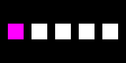
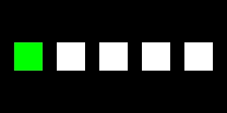

# Shader 变体保留／裁剪可视化示例

这个示例复用 `Assets/Rendering/ShaderProbe.prefab`，从真实 Bundle 加载 Keyword、Lit、Unlit、Graph、GraphEmission 五个物件。只对 Keyword 物件克隆运行时材质并切换 `PROBE_GREEN`；代码不根据构建配置改颜色，也不主动换成错误材质。

## 打开与构建

1. 如资源缺失，执行 `AI Native > Shader Variant Demo > Create missing assets`。它只补建独立的 `Assets/ShaderVariantDemo` 配置、集合和场景，不改 `Assets/Rendering/ShaderSettings.asset` 或你的 RecordedVariants。
2. 选中 `Assets/ShaderVariantDemo/Groups.asset`。本示例使用 `GroupAndAssetName`，组名 `ShaderDemo`，两条显式资源为原有 ShaderProbe 和文件名为 `Variants.shadervariants` 的集合。不要改这两个加载地址。
3. 执行 `AI Native > Shader Variant Demo > Build current configuration`，或选中 Groups 后使用资源 Inspector 的构建按钮。输出为独立的 `BuildArtifacts/ShaderVariantDemo/<版本>`，不部署到本地 StreamingAssets。
4. 执行 `AI Native > Shader Variant Demo > Open scene`，然后进入 Play。场景展示内容版本、实际 Bundle 来源，以及基础红色／绿色关键字切换按钮。Close demo 等待资源释放并停止展示。

每次重建、重新打开演示场景或修改构建内容前先退出 Play。此入口用于独立演示，不支持同一次 Play 中反复卸载后重开场景或与另一个 AssetsModule 宿主叠加使用。Editor 的源码 Shader／匹配行为可能掩盖缺失，因此**粉色缺失结论以严格匹配的 Player 为准**；Editor 不会回退到 AssetDatabase 加载资源。

## 手动制造保留、缺失与恢复

修改的是 `Assets/ShaderVariantDemo/Settings.asset`，不是原有 Rendering 下的配置。保持 Enable Processing 开启。

**保留绿色：** Required Variants 中保留以下两条，Exclusions 不排除绿色。

| 字段 | 基础变体 | 绿色变体 |
| --- | --- | --- |
| Shader | `AI Native/Keyword Probe` | 同左 |
| Pass Type | `ScriptableRenderPipelineDefaultUnlit` | 同左 |
| Pass Name | `Forward` | `Forward` |
| Keywords | 空 | `PROBE_GREEN` |

**裁掉绿色：** 删除第二条 Required Variant，然后在 Exclusions 新增：

- Shader：`AI Native/Keyword Probe`
- Match Pass Type：开启
- Pass Type：`ScriptableRenderPipelineDefaultUnlit`
- Pass Name：`Forward`
- Required Keywords：仅 `PROBE_GREEN`
- Forbidden Keywords：空

原有 `PROBE_EXCLUDED` 排除规则保留。若 Runtime Collections 有包含绿色组合的录制，先移除该录制引用；原始文件无需删除。

每次修改后，在 **Groups Inspector** 点击 **Generate declared shader variant collection**。选择新的目录，例如 `Assets/ShaderVariantDemo/WithoutGreen/Variants.shadervariants`，保持文件名 **Variants**，再把 Groups 的集合条目替换为新集合。旧生成入口不覆盖现有文件，因此不要仅生成一个新集合而忘记替换引用。也可使用合并生成入口，但自动扫描和录制中的组合同样不能与 Exclusions 冲突。

重新构建后，基础状态仍为红色；Windows 严格匹配 Player 请求绿色状态时显示粉色并记录目标变体缺失。**恢复绿色：** 删除绿色排除规则、加回绿色 Required Variant，生成新集合、替换引用并重建。

**Required 与 Exclusions 相同怎么办？** 没有覆盖优先级：同一 Shader/Pass/关键字组合同时声明必需与排除，会抛出 `RequiredShaderExcluded`，阻止生成及开启自定义处理的受管 Bundle 构建。仅删除 SVC 或 Required Variants 中的一项不等于裁掉该 Shader 的编译产物；本例的真实裁剪由 Exclusions 完成。

## Windows Player 与隔离验证

用当前手动配置构建并运行 Player（原工程的 StreamingAssets 不会改变）：

```powershell
python scripts/verify_shader_variant_demo.py TestResults/variant-present --current --backend sbp --expect present
python scripts/verify_shader_variant_demo.py TestResults/variant-missing --current --backend sbp --expect missing
```

第一条用于保留／恢复后的配置，第二条用于手动裁掉绿色后的配置。每个输出目录必须是新目录。脚本复制工程到隔离目录，将管线固定为 Forward，构建 Bundle，使用已有部署接口只更新隔离副本，然后构建 Windows Mono D3D11 Player。构建期间启用 Strict shader variant matching，结束后恢复构建设置。运行文件位于输出目录的 `sbp-current/ShaderVariantDemo.exe`；不带验证参数直接启动即可交互切换。Player 只包含独立演示场景，没有直接序列化 ShaderProbe 或材质引用。

完整自动验收命令：

```powershell
python scripts/verify_shader_variant_demo.py TestResults/variant-matrix --backend both
```

自动验收仅在隔离副本修改专用测试配置，按保留／裁掉／恢复三个状态分别构建 Builtin 和 SBP 内容，启动六个独立 Player；不提供修改原工程规则的预设按钮。每轮保存配置、集合、内容报告、Player 日志、截图和结果 JSON。

缺失验收同时检查裁剪命中、目标粉色像素和精确的目标错误日志；只接受 Unity 6000.3.23f1 对 Keyword Probe 的 subshader 0、pass 0（Forward）、vertex/pixel、仅 `PROBE_GREEN` 的缺失信息，且仅在测试的绿色渲染窗口接受。其他错误或关闭阶段错误仍失败。保留及恢复版本不能出现缺失错误；所有版本都检查红色基础和其他四个材质正常，并检查关闭后资源归零。Editor 专项测试验证真实 Bundle 来源、持续显示、切换颜色、配置初始化幂等、Required/Exclusions 冲突以及退出清理。

## 本轮验收（2026-11-12）

独立代码审查通过后，在 Unity 6000.3.23f1、URP 17.3.0、SBP 2.6.2 上重新执行：

- Windows Mono、D3D11、URP Forward：Builtin／SBP 两种 Bundle 后端的保留、裁掉、恢复共六个独立 Player 全部通过。两个裁掉版本均有绿色规则命中、目标变体缺失日志和粉色像素；保留／恢复没有缺失错误。
- Editor Domain Reload 开／关：专项测试各 3 项通过，覆盖持续展示、真实 Bundle 来源、红绿切换、初始化幂等、冲突和关闭清理。通过控制器 API 操作，不宣称已执行鼠标按钮自动化。
- 原有资源基准回归：EditMode 110 项、PlayMode 55 项全部通过。首次沿用本地 GroupName 命名偏好时，旧测试的固定哈希包名断言失败（109 通过、1 失败）；仅在隔离副本恢复已提交的 ResourceGroups 基准后重跑，本地偏好未修改，首次失败材料仍保留。
- 归档日志未发现 JobTempAlloc／TLS 临时分配警告。本轮不扩大为 IL2CPP 或 Forward+ 验收声明，也未向原工程 StreamingAssets 部署测试内容。

证据包含[结果汇总](evidence/assets-shader-variant-demo/summary.json)、[源码指纹](evidence/assets-shader-variant-demo/sources.json)、[归档文件哈希](evidence/assets-shader-variant-demo/files.json)及[完整日志、配置、裁剪报告、XML 和截图](evidence/assets-shader-variant-demo/evidence.zip)。

裁掉绿色（左侧目标粉色，其他物件正常）：



恢复绿色：


