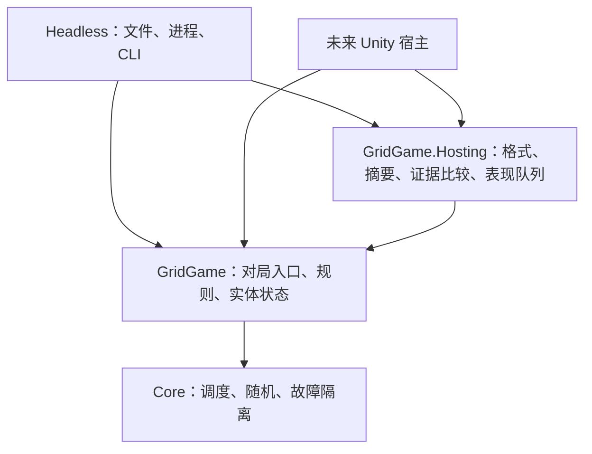

# 第三阶段前：宿主边界与表现契约

> 历史记录：本文保留当时的设计与验证证据；当前运行入口及契约已迁移到 [v2](framework-v2.md)，本文旧命令不作为当前验收入口。
本次修复架构审查的五项问题：场景解析分叉、共享能力绑定 Headless、恢复与宿主对比混用、对局所有权松散、表现步骤与逻辑状态缺少绑定。实现、独立审查和审查后本地验证已完成，证据见文末。Unity 工程、动画、截图及 Unity/IL2CPP 运行验证仍属于第三阶段。

## 1. 模块与依赖决策



新增 `AiNative.GridGame.Hosting`，目标为 netstandard2.1 / C# 9；Core 与 GridGame 继续不引用 JSON、Unity、文件和网络。共享库只处理内存字节、不可变状态和显式方法调用。Headless 保留环境探测、文件读取、原子发布、参数解析、stdout/stderr 及退出码。

新增项目解决第二个宿主必须复用实际协议实现的问题。移动已有快照/回放编解码、规范化与差异实现，避免为跨宿主比较复制严格校验器；没有新增插件注册、通用序列化接口或服务框架。仅面向宿主实际需要的能力公开 API，协议实现细节仍为 internal。Headless 与现有测试通过友元程序集复用内部编排类型，未来宿主使用下表公共入口。

共享库固定引用 [System.Text.Json 10.0.14](https://www.nuget.org/packages/System.Text.Json/10.0.14)，该包提供 netstandard2.0 目标。选择它是为了保留已验证的 JSON DOM/显式 writer 行为，避免自研解析器或维护第二套格式。所有传递依赖由 `packages.lock.json` 固定；解析场景改为显式字段读取，不使用反射反序列化。net10.0 消费方可能由 SDK 将平台自带包剪枝，实际加载程序集始终进入构建身份检查。

Unity 接入时须验证锁定依赖的导入、冲突和 AOT 行为。当前 netstandard 构建和 .NET 测试不替代 Unity 编译或 Player 验收。第三阶段不得直接引用 net10.0 Headless，也不得复制共享库源码形成第二份实现。

## 2. 对局所有权与公共入口

| 入口 | 契约 |
| --- | --- |
| `GridGameRuntime.Create(configuration, seed)` | 校验并复制配置，独占规则实例与 Session |
| `GridGameRuntime.Restore(snapshot)` | 创建候选实例；校验玩法/会话及 `turnIndex - 1 <= completedStepCount`，失败不修改旧实例 |
| `Submit(command)` / `Advance()` | Submit 仅入队；Advance 执行一条，空队列返回 null，故障后停止使用 |
| `GetState()` / `Capture()` | 分别返回隔离视图、含玩法/随机/调度位置的不可变 `GridObservation`；不推进 |
| `ExportState()` | 仅健康空队列返回 `GridGameSnapshot`；内部连续捕获会话和规则，宿主不能传入另一实例的规则引用 |
| `GridStep.Step` / `GridStep.State` | 同一已完成命令的 `StepResult` 与精确后状态，拒绝也产生步骤，空推进不产生 |
| `ScenarioCodec.Decode(bytes)` | 所有宿主共用的严格场景 v1 解析；仅 A/B 大小写形式合法，组合与填充字符串非法 |
| `CommandFile.Decode(bytes)` | 返回隔离的 submit/advance 序列，检查格式版本与最终队列平衡，不裁定玩法 |
| `CanonicalState.ConfigurationBytes/StateBytes/Hash` | 复用原 v1 规范化字节和 SHA-256；环境与表现状态不进入玩法摘要 |
| `SnapshotCodec.Encode(snapshot, environment)` / `Decode(bytes, environment, expectedConfiguration)` | 内存编解码；Decode 仍严格检查来源环境并返回候选对局 |

`GridGameSnapshot` 包含不可变 `SessionState` 与 `GridGameState`，其构造成功不代表通过恢复校验。`GridObservation` 可以包含待执行队列计数，不能当作完整快照恢复。对局实例身份只用于识别表现生命周期，不进入文件、摘要或跨宿主比较，也不保留可写运行对象引用。

Headless 的演示、批处理、快照保存和恢复均使用 `GridGameRuntime`。原 Core/GridGame 底层 API 保留给规则扩展及其行为测试；宿主和表现代码不持有可执行的 `GridGameRules` 或独立 Session 引用。需要攻击动画的宿主可按提交序号保留命令上下文，规则结果仍以 `GridStep` 为准。

场景领域校验仍由玩法模块负责。共享输入错误抛 `ProtocolException`，提供 `Code` 和 `Path`；CLI 在边界映射为 InputError，旧 `ScenarioLoader.Load` 保持 JsonException 类型。批处理继续遵守“全部输入结构 → 版本 → 环境 → 内容/领域”的错误优先级。

## 3. 严格恢复与宿主证据比较

保存、恢复、`run --snapshot`、`inspect` 和 `replay` 继续执行原环境门禁，不增加跳过环境选项。新增 `HostVerification.Record(configuration, seed, commands, environment)` 在调用宿主中从新局独立执行，返回原 v1 回放字节；不读取文件，不伪造 Unity 来源。第三阶段自动验收驱动可以调用它，交互输入映射仍须另行验证。

新增 `HostVerification.Compare(expectedBytes, actualBytes)` 只比较两份已有证据，不执行记录中的命令、不安装对局。先校验两份记录的版本、配置、状态摘要、不变量、检查点完整性和调度，再要求相同配置、初始状态（包括随机状态）、起始调度位置与完整操作序列。输入不同返回 `ComparisonInputMismatch`，不把不同实验解释为规则分歧。

比较允许来源 runtime/OS/架构/buildHash 不同，但保留两边来源；逐点比较 state、session、result 与有序事件，首个分歧即停止。`HostComparison` 提供两份环境、已匹配检查点数、分歧 operationIndex/sequence 与字段差异。匹配只证明这两份输入证据一致，不授予任意跨环境恢复兼容性，也不认证外部证据的真实性。

```sh
dotnet run --project src/AiNative.Headless -- compare --expected headless.replay.json --actual other-host.replay.json
```

compare 复用 CLI 结果 envelope：匹配为 Completed / HostTracesMatched、退出 0；有效结果分歧为 ReplayDivergence / CheckpointMismatch、退出 3；损坏或不同实验输入退出 2；文件输出等宿主故障退出 1。参数仅接受各一次 `--expected` 与 `--actual`。不执行模拟，因此 accepted/rejected 为 0，initialCheckpoint/finalCheckpoint 为 null，checkpoints 为空；comparedCheckpoints、location 和 divergence 表达证据比较结果。来源环境仍保存在各输入记录中，可由公共 `HostComparison` 读取。

协议 v1 的快照、回放、玩法摘要字段与固定状态字节保持不变。实际加载代码增加后，buildHash 的组合清单更新为 Core、GridGame、GridGame.Hosting、Headless、System.Text.Json、System.Text.Encodings.Web、System.IO.Pipelines，按此顺序分别散列完整程序集，再组合 `名称=摘要\n` 的 UTF-8 文本。旧构建记录继续因身份不同被拒绝恢复，不静默迁移。旧三项虚拟构建向量保留为组合编码测试，不代表当前生产清单；实际七项清单另有测试。

## 4. 表现消费与生命周期

`GridPresentationQueue` 属于宿主适配库，不能推进模拟或修改规则。宿主按以下顺序使用：

1. 用当前对局的 `Capture()` 初始化队列和画面。输入按到达顺序 Submit；由显式驱动 Advance，不能把 Unity 帧数当作规则时间。
2. 非空 Advance 返回的 `GridStep` 立即 Enqueue。必须属于同一对局且步骤连续；业务拒绝也保留，重复、缺步或旧对局步骤明确拒绝。
3. BeginNext 取得下一步；当前步未完成不能开始另一步。每次动画/异步回调写入画面前必须先检查 IsActive(step)，失效即返回；有效时按本步事件和 State 更新画面，结束时 Complete 同一个步骤对象。有效性检查、画面写入与 Complete 必须位于同一主线程同步调用内，中间不能 await 或让出执行。
4. Complete 成功后更新 Presented；重复或已取消动画的旧回调返回 false。表现速度只改变消费速度，不能重新裁定移动、伤害或胜负。
5. 重载/恢复先构造并校验候选对局。成功后宿主取消旧动画、替换对局、Reset 新观察并重建画面；失败保留旧对局和表现。Reset 清空待播/在播步骤，使旧完成回调失效。
6. 截图目标先捕获逻辑检查点；只有 `IsSettledAt(checkpoint)` 为 true，再完成相机/UI 刷新后截图。该方法要求同一对局、相同步骤、逻辑队列为空且无待播步骤。截图记录对应状态摘要，不使用截图后的最新状态代替。

动画期间允许输入继续入队，但是否推进仍由同一同步驱动控制。第三阶段若禁用部分人工输入控件，须把此交互策略与自动命令驱动区分；固定操作序列的结果不得受播放速度影响。该队列不提供动画实现或自动截图，也不引入全局事件总线和回调注册。

## 5. 验证与交付记录

本轮实现责任：主 Agent；最终审查由独立 Reviewer Agent 承担，审查后的检查由主 Agent 执行。原第二阶段测试与真实 CLI 验收继续保留；新增 `HostBoundaryTests` 覆盖三个输入入口、完整对局恢复、独立调用路径的记录比较、严格环境拒绝、输入不同与记录损坏、compare CLI 和依赖方向；`PresentationTests` 覆盖快慢消费、历史状态、拒绝步骤、重载中断及过期回调。

2026-11-03，独立 Reviewer `host_boundary_review` 完成只读审查，发现旧动画回调在 Complete 前可能先写入新画面的 P2 问题。新增 IsActive 写入前检查，明确同一同步主线程调用要求，并补回归断言；Reviewer 复核关闭该问题，无剩余阻断项。Reviewer 没有代替主 Agent 执行测试。

审查后实际检查：

- `dotnet restore --locked-mode` 通过；`dotnet build --no-restore` 通过，0 警告、0 错误。
- `dotnet test --no-build --no-restore --logger trx --results-directory TestResults/host-boundary-20261103-reviewed-unit`：355 项通过，0 失败、0 跳过，TRX 已保存。
- `dotnet format --verify-no-changes --no-restore`：退出 0。工作区加载仍有项目引用元数据匹配警告；不将此结果描述为额外分析器门禁已接入。日志位于 `TestResults/host-boundary-20261103-reviewed-format.log`，详细诊断位于 `TestResults/host-boundary-20261103-format.log`。
- `python scripts/verify_phase2.py --output TestResults/host-boundary-20261103-reviewed-cli`：45 次实际 CLI 调用全部符合期望，含原 40 次及新增 5 次，summary 和每次 stdout/stderr 已保存。
- 修改文档的本地链接与 `git diff --check` 通过；六组原有固定字节/hash 向量由上述测试验证，没有修改期望字节。

证据在本地被忽略的 TestResults 中，可用上述入口重建（CLI 输出目录必须使用新路径）。验证基于 `37fedbc` 加本轮改动，Windows/x64、SDK 10.0.202、runtime 10.0.13。未执行 Unity、IL2CPP、真实另一运行时宿主或本轮远端 CI；不同来源标签测试与共享驱动/CLI 两条调用路径比较不替代这些验收。
