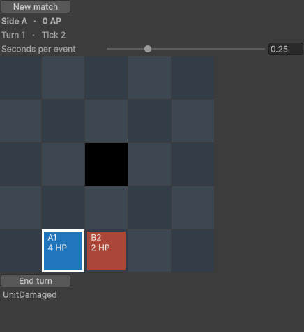

# 第三阶段 · GridGame 接入 Unity Editor

Windows x64 上，Unity Editor 和无头 CLI 各自执行同一场 GridGame。8 个 Tick 的输入结果、有序事件、权威状态和摘要逐项相同。不同表现速度各通过 16 个检查点的比较。固定操作的最后一击在 Tick 8 结束对局，A 方获胜。[机器验收摘要](evidence/phase-3/grid-editor/summary.json)

## 打开示例

GridGame 的独立 Unity 工程根目录是 [examples/unity/GridGame](../examples/unity/GridGame)。`examples/unity/` 仅用于归类，Unity Hub 或 CLI 应打开具体游戏的目录。`Packages/` 和 `ProjectSettings/` 随 GridGame 提交，保存它的产品身份、Editor 版本和工程设置。需要 Python 3.10+、仓库指定的 .NET 10 SDK、Unity CLI 和已授权的 **Unity Editor 6000.3.23f1**。在仓库根目录运行：

```sh
python scripts/unity_grid.py prepare
unity open examples/unity/GridGame
```

打开菜单 **Window > AI Native > GridGame**，直接在编辑模式操作。点击己方单位，再点击相邻格移动，或点击敌人攻击。`End turn` 切换阵营，`New match` 开新局。滑块调节每个事件的动画时长。窗口展示已完成表现的 Tick、行动方、行动点、单位生命和规则反馈。

下图来自一次单独的桌面操作检查。实际窗口先选 A1、向右走一格，再点击 B2 攻击。每次点击命令单独推进，所以截图是这局的 Tick 2。批处理向量把移动和攻击放在同一 Tick，二者有各自的操作序列。



## 两个宿主如何复用一套规则

- `prepare` 按仓库 lock 文件恢复并发布 GridGame 适配器的 netstandard2.1 程序集，将四个项目 DLL 和五个 JSON 运行依赖复制到该游戏工程的 Editor 插件目录。它同时将 CLI 使用的场景复制到该工程的 `Assets/StreamingAssets/grid.scenario.json`。窗口和批处理都从本工程读取场景，验收先核对这份文件与 CLI 输入逐字节一致。NuGet 源包集中于 `third_party/nuget`。
- Editor 显式注册 `GridGameModule`。两个宿主共用 `GameRegistry.ReadScenario` 和同一个游戏模块创建对局。Editor 额外取得以该对局初始观察建立的顺序表现队列。真正的移动、攻击、业务拒绝和胜负都由 GridGame 在 `Advance` 中裁定。
- 窗口将点击翻译成 `Move`、`Attack` 或 `EndTurn`。每帧绘制读取当前表现帧自带的观察和事件，主线程时钟只控制插值和命中反馈。关闭或重开窗口会清空旧队列、使旧帧失效并释放旧对局。
- 批处理通过同一个 Editor 会话和 `HostVerification.Record` 生成 v2 记录。环境身份含实际加载的插件、窗口代码、Unity 模块和 Editor 版本。验收脚本逐个核对九个插件的 SHA-256。Editor 不引用 Runner、Headless 或 Jolt。

## 复现逐 Tick 比较

先关闭正在使用这个示例项目的 Editor。以下命令要求新的输出目录。

```sh
python scripts/unity_grid.py verify --output TestResults/grid-editor
```

1. 脚本复制 [场景](../examples/data/grid.scenario.json) 和 [操作](../examples/data/grid.commands.json)，使用种子 42。启动真实 Unity Editor，快、慢两局各生成自己的 v2 回放。快局每个 Tick 立即消费，慢局先积压 8 个 Tick 再按顺序播放。两局逐帧检查单位位置、生命、行动方、行动点和胜负。另用窗口输入处理路径验证选择、移动插值、命中反馈、结束回合、胜负及旧动画失效。
2. Editor 退出后启动真实 .NET CLI，它独立从场景和种子创建游戏并执行操作。CLI 的 `compare` 对比初始检查点和 15 个操作检查点，包括 7 次提交和 8 次推进。操作包含零输入 Tick、拒绝、同 Tick 多输入及终局。比较覆盖运行计数、随机状态、完整玩法状态、输入结果和有序事件。
3. 脚本在记录副本中将 Tick 2 的拒绝原因从 `NotYourTurn` 改成 `Blocked`。CLI 必须以退出码 3 返回 `CheckpointMismatch`，首个分歧位于零基操作索引 2 的 `$.result.inputs[0].error`。

输出目录保存输入副本、Editor 日志、三份原始回放、负对照记录、各 CLI 进程的 stdout/stderr 和摘要。仓库保留可直接交给 v2 `compare` 的[无头回放](evidence/phase-3/grid-editor/cli.replay.json)、[即时消费回放](evidence/phase-3/grid-editor/editor-fast.replay.json)和[滞后消费回放](evidence/phase-3/grid-editor/editor-slow.replay.json)。

## 验收记录

| 本轮 Windows x64 检查 | 结果 |
| --- | --- |
| Unity 6000.3.23f1 与 .NET 10.0.13 独立执行 | 快、慢各 16 个检查点均为 `HostTracesMatched`，6 次接受、1 次拒绝 |
| 第 8 Tick 的状态摘要 | `d5ba0ae55780a643f527af84b8e8a1d4f51abf6ed7452543e2da3d5648d839bf` |
| 人为改变拒绝原因 | 精确定位第 2 Tick 的输入结果差异 |
| 桌面窗口 | 向实际 Editor 窗口发送 MouseDown/MouseUp，驱动选择、移动、攻击；核对 Tick 2 窗口截图 |
| 无头回归 | .NET 构建、236 项测试、108 次真实 CLI 验收、原生损坏探针及只读格式检查通过 |

独立审查将准备好的 GridGame 单独复制到仓库外，使用相同版本的 Editor 首次导入并运行，快慢两份记录均匹配 CLI 的 16 个检查点。该副本只从工程的 StreamingAssets 读取默认场景。

本轮验收范围为 Windows x64 上的 GridGame Editor。PhysicsSandbox 的 Unity 接入、独立 Player、IL2CPP 和其他平台的 Editor 属于后续工作。现有云端 CI 执行无头回归，本页的 Unity 证据来自本地授权的真实 Editor。
