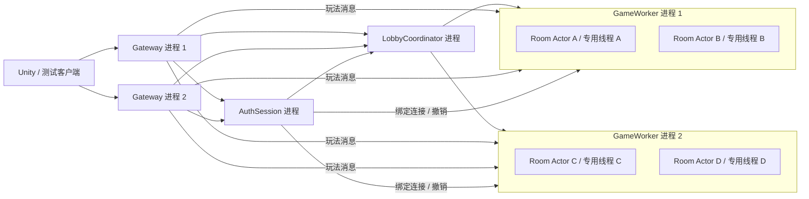
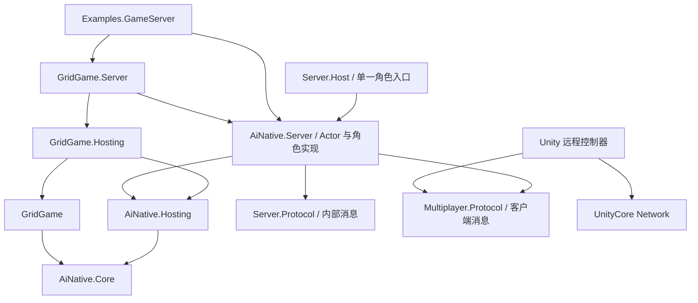
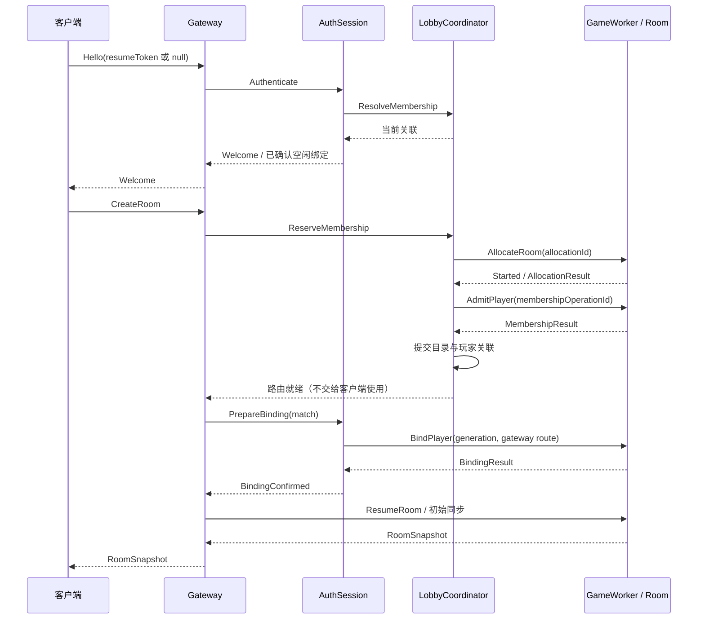
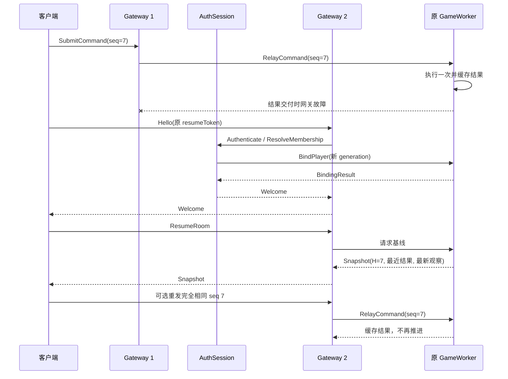
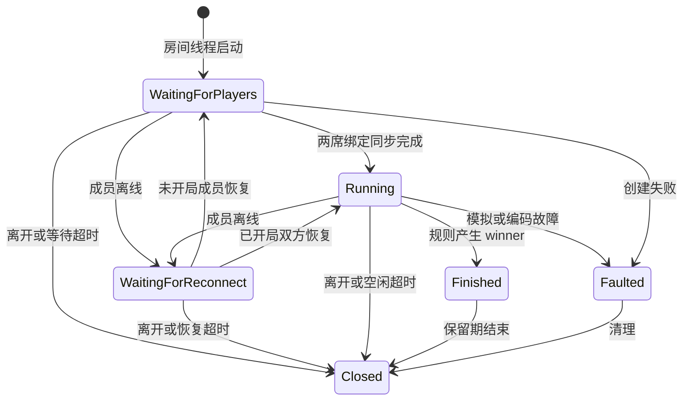
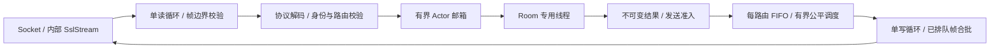

# 服务器端架构设计

状态：多进程设计基线，已开始 S1 基础实施，整体服务器尚未完成、尚未运行联机验收。日期：2026-11-26。[实施记录](server-implementation.md)区分实际代码、基础测试与剩余工作。本文替换此前的单进程首期方案，不据此宣称已有联机、跨进程部署、高可用或性能能力。第 10 节补充质量目标与高可用演进，第 11 节规定基础网络性能设计；后续 H 阶段不改变首期故障承诺。

采用独立权威服务器、Actor 状态隔离和多进程部署。首期双人 GridGame 验证客户端断线与跨网关重连；每个 Game 进程承载多个 Room Actor，每个房间独占一条线程。最近的线程评估未改变该约定，未来调整执行策略须另行修订。**房间 Actor、房间线程和 Game 进程是三个不同层级，不采用每房间一个进程。**

遵循[总设计](ai-native-game-engine-design.md)、[架构规范](engineering-guidelines.md)与[v2 契约](framework-v2.md)，实际已有能力见[验收索引](acceptance-index.md)。除实施记录明确列出的基础类型外，本文服务、配置及协议仍为待实施设计。

## 1. 商业方案参考与采用边界

参考日期为 2026-11-26，采用各产品官方公开资料。下表区分来源事实与本工程选择，不把商业产品能力视为本项目能力。

| 来源 | 官方公开的架构要点 | 本工程采用与差异 |
| --- | --- | --- |
| [Photon Server 5 LoadBalancing](https://doc.photonengine.com/server/v5/applications/loadbalancing/application) | Master 维护房间目录和 Game Server 负载，Game Server 承载房间；客户端通过 Master 获取对局地址 | 采用目录／调度与对局承载分离。本工程客户端经独立 Gateway 转发，不照搬客户端切换直连 Game 的流程；Photon 的逻辑应用也不能直接等同本项目的 OS 进程 |
| [Amazon GameLift Servers 工作原理](https://docs.aws.amazon.com/gameliftservers/latest/developerguide/gamelift-howitworks.html) | 区分后端、会话分配、游戏服务器与托管容量；该托管流程中每个游戏服务器进程一次承载一个会话 | 采用分配、ready／health、容量和进程生命周期的边界。本工程一 Game 进程承载多个轻量房间，不接入 GameLift、不照搬其进程粒度 |
| [Nakama 权威多人游戏](https://heroiclabs.com/docs/gameplay-multiplayer-server-multiplayer/) | 权威 match 的处理和状态归特定实例所有，由服务器验证与广播 | 采用每局唯一权威所有者，避免跨节点共同修改模拟；不引入 Nakama，也不采用其容量宣称 |
| [Orleans 调度模型](https://learn.microsoft.com/en-us/dotnet/orleans/implementation/scheduler) | Actor 串行执行不要求始终在同一线程，调度可复用线程池 | Actor 模型与线程策略分开。非房间 Actor 使用共享串行执行器；房间专用线程是本项目明确选择，并非 Actor 的必要条件 |

据此选择：将长连接、身份、目录调度和模拟放入不同进程，使连接扩容、房间分配与模拟故障拥有独立边界。该选择是针对现有纯 C# 内核的设计推导，不宣称所有商业游戏采用同一拓扑。

## 2. 现有基础与保留边界

| 当前实现 | 复用点 | 必须新增的能力 |
| --- | --- | --- |
| [SimulationRuntime](../src/AiNative.Core/SimulationRuntime.cs) | Submit 排队、Advance 消费输入并推进、单实例串行和故障终止 | 房间 Actor 在唯一 Game 进程内拥有运行时；网络身份、请求去重和时钟不进入 Core |
| [IGameModule / IHostedGame](../src/AiNative.Hosting/IGameModule.cs) | 创建完整游戏、输入编解码、结果与观察 | 仅 Game 装配游戏；Gateway、Auth、Lobby 不加载玩法或解释移动、攻击规则 |
| [Headless](../src/AiNative.Headless/CliRunner.cs) | 离线 replay／compare | 新建长期运行服务入口，不把 CLI 扩成网络循环 |
| [Unity PlayHost](../packages/com.ainative.unity/Runtime/PlayHost.cs) | 单机时钟与表现 | 联机客户端另建远程对局控制器，只发送意图和呈现权威观察 |
| [UnityCore Network](../packages/com.ainative.unitycore.network/README.md) | 客户端 TCP 连接与四字节长度帧 | 多网关重连、业务协议、内部进程连接和认证；SendAsync 完成不代表业务执行 |
| [实时表现缓冲](../src/AiNative.Hosting/Presentation/RealtimePresentationBuffer.cs) | 观察与事件分离原则 | 网络基线可跳 Tick，另用本地表现代次；不能伪造 Core 的不可序列化实例身份 |

网络观察、完整快照和回放证据严格区分。观察仅包含可公开状态；恢复快照仍要求匹配环境；回放不包含完整的跨进程成员事务与在线身份，不能直接作为生产恢复日志。物理同环境复现不构成跨平台帧同步承诺。

首期不建设预测回滚、增量同步、兴趣管理、观战、自动匹配、数据库或远程 Actor 自动发现。进程划分已经落入首期；账号运营体系、持久化和高可用仍为后续阶段。

## 3. 多进程部署与所有权

### 3.1 四类实际进程



图中的每个 Gateway、AuthSession、LobbyCoordinator 方框及 GameWorker 子图均为独立 OS 进程；子图内部是该进程拥有的房间 Actor 与线程。同机运行仍通过真实 Socket 通信，不退化为进程内调用。

| 角色 | 首期实例数 | 唯一拥有的状态与职责 | 不拥有的职责 |
| --- | --- | --- | --- |
| Gateway | 2，可横向增加 | 客户端 Socket、ConnectionActor、帧解析、连接限流、已确认路由缓存、发送预算 | 不保存权威玩家身份、席位、去重记录或游戏状态；缓存不可作为权限来源 |
| AuthSession | 1 | IdentityActor、每玩家 PlayerSessionActor；凭证摘要、当前／候选连接代次、认证与绑定编排 | 不拥有玩家房间归属，不推进模拟；不在每个 Tick 上被同步调用 |
| LobbyCoordinator | 1 | RoomDirectoryActor、AllocationActor；房间归属、玩家成员预留、Worker 注册／容量、控制 epoch | 不裁定玩法，不持有模拟状态；客户端玩法消息不经过它 |
| GameWorker | 2，可横向增加 | WorkerSupervisor、RoomRegistryActor、多个 Room Actor；席位、命令去重、权威 Tick、公开观察 | 不拥有账号身份或全局房间目录；不能自行把房间迁移到别的 Worker |

每个进程另有本地 LifecycleSupervisor 与 DiagnosticsActor。日志归本进程输出，部署层统一收集；诊断不额外建设必需的网络服务。

首期验收拓扑为 **2 Gateway + 1 AuthSession + 1 LobbyCoordinator + 2 GameWorker，共 6 个进程**。这样才能验证跨网关重连、Worker 故障隔离及多 Worker 分配。单 Gateway + 单 Worker 可用于快速调试，但不能替代多进程验收矩阵。

### 3.2 控制路径与玩法路径

- 控制路径：客户端 → Gateway → AuthSession／LobbyCoordinator → 指定 GameWorker，负责登录、分配、加入和连接绑定。
- 玩法路径：客户端 → Gateway → 房间所属 GameWorker → Gateway → 客户端。命令结果、事件与观察不经过 AuthSession 或 LobbyCoordinator。
- 每局只有一个 Worker 所有者，房间内部保持串行；多进程并不把单局规则拆到不同进程共同执行。
- Gateway 是连接故障边界，Worker 是多局模拟故障边界。进程间不共享堆、单例或可变静态字段；机器故障仍可能同时影响同机全部进程。
- 后续自动匹配作为独立 Matchmaker 进程，只输出组局提案，由 Lobby 统一完成成员预留和分配。后续账号数据服务／数据库拥有长期数据，不让 Gateway 直接写业务表。

选择网关转发便于统一入口和跨 Worker 路由，代价是增加一次内部转发及网关带宽开销；这些必须测量。未来强实时玩法可评估客户端直连 Game 或 UDP 通道，但首期保持 TCP 和单客户端连接。

### 3.3 模块依赖与构建

拟议使用一个通用角色启动程序 `AiNative.Server.Host`，按显式配置分别启动 gateway、auth、lobby 三种进程；游戏工作进程由 `AiNative.Examples.GameServer` 显式注册 GridGame 适配。不同角色始终分别启动，不在一个 Host 进程里合并四种角色。



Server、Server.Protocol 及服务入口为 net10.0；Multiplayer.Protocol 为 netstandard2.1/C# 9。复用已锁定 System.Text.Json，不引入游戏规则 DSL、容器或反射扫描。Server 可使用 Hosting 的通用接口与规范编码，但只有 Game 角色创建游戏。内部协议不引用服务对象，客户端不得引用内部协议。Core、Hosting、IGameModule/IHostedGame 与 v2 文件协议保持现有签名及依赖边界。

以上为目标项目名，按实际实现创建项目；不预先创建空工程。

### 3.4 目录结构与项目职责

以下是相对于仓库根目录 `C:\work\github\ai_native_game_engine` 的目标布局。当前仅创建 Server 的 Actors／Transport 和 Server.Tests 的对应基础测试；其余服务器项目、配置、脚本均为后续交付。按实际实现逐步建立，不预先生成占位接口或空目录。项目内部子目录用于组织职责，不是独立程序集。

```text
src/
├── AiNative.Multiplayer.Protocol/       # 客户端可共享，netstandard2.1
│   ├── Messages/                       # 登录、房间、命令、观察消息
│   └── Serialization/                  # 编解码与结构校验
├── AiNative.Server.Protocol/            # 服务端内部协议，net10.0
│   ├── Messages/                       # 注册、分配、成员、绑定、路由消息
│   └── Serialization/                  # 内部信封与协议校验
├── AiNative.Server/                     # 服务器实现库，net10.0
│   ├── Actors/                         # 引用、有界邮箱、串行执行器
│   ├── Transport/                      # TCP 帧、认证 ServerLink、收发预算
│   ├── Gateway/                        # ConnectionActor、客户端路由
│   ├── Auth/                           # IdentityActor、PlayerSessionActor
│   ├── Lobby/                          # 房间目录、成员预留、Worker 分配
│   ├── Game/                           # Worker、Room Actor、游戏适配契约
│   ├── Lifecycle/                      # 监督、启动、排空、关闭
│   ├── Configuration/                  # 部署与角色配置读取、校验
│   └── Diagnostics/                    # 指标、日志和证据输出
└── AiNative.Server.Host/                # 通用角色可执行入口
    └── Program.cs                      # 显式选择 gateway/auth/lobby

examples/
├── AiNative.GridGame.Server/            # 权限映射、公开配置与终局适配
├── AiNative.Examples.GameServer/        # GameWorker 可执行入口
│   └── Program.cs                      # 显式装配 GridGame
└── server/
    └── local/
        ├── README.md                   # 六进程启动、停止、故障验证说明
        └── deployment.json             # 非敏感拓扑、端点和预算配置

tests/
├── AiNative.Server.Tests/               # 独立服务器测试项目
│   ├── Protocol/
│   ├── Actors/
│   ├── Transport/                      # 分帧、异步收发、背压和缓冲生命周期
│   ├── Gateway/
│   ├── Auth/
│   ├── Lobby/
│   ├── Game/
│   ├── Integration/                    # 六进程、重连、分区与故障测试
│   ├── Performance/                    # 网络／对局容量和持续负载场景
│   └── Fixtures/                       # 时钟、连接、进程管理夹具
└── AiNative.Server.TestClient/          # 独立进程测试客户端

scripts/
└── server/
    ├── start_local.py                  # 按清单启动并等待 Ready
    ├── stop_local.py                   # 只关闭该次运行拥有的进程
    └── verify_server.py                # 六进程验收与证据汇总

docs/
└── server-architecture.md              # 架构、目录、协议和验收设计

artifacts/server/<run-id>/              # 临时证书、进程清单和运行产物
TestResults/server/<run-id>/            # 报告、日志、回放及故障证据
```

每个项目目录在实施时包含同名 `.csproj`，沿用仓库现有构建属性、锁定依赖和代码风格。两个协议项目只共享消息约定，不通过双向引用共用类型；客户端协议不得依赖内部协议。

| 项目 | 目标／类型 | 直接项目引用与职责边界 |
| --- | --- | --- |
| AiNative.Multiplayer.Protocol | netstandard2.1 / 类库 | 不引用服务器、Unity 或具体游戏；提供客户端可移植 DTO 与编解码 |
| AiNative.Server.Protocol | net10.0 / 类库 | 不引用 Actor 实现或游戏；仅提供内部 DTO、信封和编解码 |
| AiNative.Server | net10.0 / 类库 | 引用两个协议项目及 AiNative.Hosting；不得反向引用 Example |
| AiNative.Server.Host | net10.0 / 可执行程序 | 引用 AiNative.Server，只负责配置、角色选择与显式启动 |
| AiNative.GridGame.Server | net10.0 / 类库 | 引用 AiNative.Server 的游戏适配契约及 AiNative.GridGame.Hosting；不拥有监听或进程生命周期 |
| AiNative.Examples.GameServer | net10.0 / 可执行程序 | 引用 AiNative.Server 与 AiNative.GridGame.Server，显式装配 Worker 与游戏 |
| AiNative.Server.TestClient | net10.0 / 可执行程序 | 引用 AiNative.Multiplayer.Protocol，使用系统 Socket；不引用内部协议或游戏实现，不绕过客户端边界 |
| AiNative.Server.Tests | net10.0 / 测试项目 | 引用两个协议项目、Server 和 GridGame.Server；通过项目构建依赖准备两个服务入口与 TestClient，集成测试以子进程调用，不调用其 Program |

服务器测试独立于既有 `AiNative.Tests` 的物理构建入口，不设置 CopyNativeBridge，不要求构建 Jolt；测试框架沿用仓库已锁定版本。项目构建依赖只用于准备进程制品，不能产生产品对测试的引用。Unity 远程控制器只共享 Multiplayer.Protocol 并使用现有 UnityCore Network，不引用 Server 或 Server.Protocol。

后续只将实际创建的纯 .NET 项目加入根解决方案；Unity 生成项目不加入。本次不修改解决方案中已有的其他变更。

### 3.5 六进程入口与配置归属

下表是首期配置映射，不是已存在的可执行命令。角色选择和 serviceId 必须与部署清单一致，同一个可执行程序的不同启动实例拥有独立进程、堆和 bootId。

| serviceId | 角色 | 可执行项目 | 首期端点 |
| --- | --- | --- | --- |
| gateway-1 | gateway | AiNative.Server.Host | 客户端回环 18082；内部主动连接其他角色 |
| gateway-2 | gateway | AiNative.Server.Host | 客户端回环 18083；内部主动连接其他角色 |
| auth-1 | auth | AiNative.Server.Host | 内部 18100 |
| lobby-1 | lobby | AiNative.Server.Host | 内部 18101 |
| worker-1 | game | AiNative.Examples.GameServer | 内部 18201 |
| worker-2 | game | AiNative.Examples.GameServer | 内部 18202 |

`examples/server/local/deployment.json` 保存上述稳定 serviceId、角色、端点、允许的非敏感证书身份、版本／配置摘要及预算；`README.md` 说明前置条件和启动顺序。密钥材料、临时凭证、PID、实际 bootId 与运行清单只放入 `artifacts/server/<run-id>/`，不回写部署清单。运行产物及 `TestResults/server/<run-id>/` 已由仓库现有忽略规则覆盖；证据必须脱敏，禁止复制证书私钥或原始凭证到测试报告。

`start_local.py` 为一次运行创建独立 run-id，按第 9.3 节顺序启动并检查 Ready，保存属于该次运行的进程身份；`stop_local.py` 只接收该运行清单，核对 PID、启动身份及可执行路径后发起关闭，防止 PID 复用误伤其他进程。禁止按进程名批量终止、关闭其他运行或清理整个 artifacts。`verify_server.py` 使用独立运行目录，调用启停流程并汇总六进程测试、故障与清理结果；输出目录不覆盖既有证据。

## 4. Actor 与线程模型

### 4.1 状态隔离

所有有状态服务遵守 Actor 约定：单一所有者、串行邮箱、不可变消息、显式生命周期。Gateway 的 ConnectionActor、Auth 的 PlayerSessionActor、Lobby 的目录／分配 Actor 及 Worker 的注册／监督 Actor 使用共享串行执行器，一个 Actor 同时只处理一个消息；无需固定线程身份。

每个 Room Actor 自建一条 System.Threading.Thread，从启动到退出保持同一线程。全部房间消息、模拟创建、Submit、Advance、Observe、证据捕获和 Dispose 均在该线程执行。不同房间线程可并行；不设原单进程方案的全局模拟执行信号量，每个 Worker 以房间线程预算接纳新局。

房间空闲时等待邮箱或最近期限，不忙轮询。房间线程不做 Socket／文件 I/O，不同步等待其他 Actor，不用 async/await 执行业务以免续体迁移线程。外部 I/O 完成只投递结果消息，业务状态在处理该消息时修改。游戏模拟与适配是房间私有协作对象，不是远程寻址对象。

本地 Actor 引用只提供 `TryPost` 和 actorId/incarnation，结果 Accepted、Full、Stopped 只说明邮箱接纳。消息不携带可变集合、Socket、模拟对象或访问其他 Actor 的委托；借用正文必须复制或明确转移所有权。邮箱短锁只保护入队顺序，不用于跨 Actor 共享业务状态。

### 4.2 跨进程是显式消息边界

跨进程使用显式 ServerLink，不伪装成永远可靠的本地 Actor 方法调用。不实现远程对象代理、分布式锁或透明 Actor 迁移。接收端验证并解码后，将 DTO 投递到本地目标 Actor。

发送完成、远端收到、邮箱接纳和业务提交是不同阶段。响应以 operationId 关联；超时表示结果未知，不能据超时就重做非幂等操作或释放成员预留。同一连接 FIFO 不等于跨连接有全局顺序；断线重连后通过业务操作记录及房间请求序号去重。

每个待确认操作都有有界状态和明确的终止／查询路径，处理函数不能对其他 Actor 或 ServerLink 的任务 Wait/Result。故障通知由所属进程 Supervisor 接收，不自动重启空状态的 Actor 来冒充原实例。Room 故障终止该局，Worker 注册 Actor 等关键状态丢失则退出该 Worker；Auth／Lobby 关键状态丢失进入控制集群重启流程。

## 5. 进程间协议与路由身份

### 5.1 内部链路

内部使用长连接 TCP、四字节大端正文长度与 JSON，独立 `serverProtocolVersion: 1`。通过 .NET TLS 双向证书验证连接双方，部署配置显式映射允许的证书身份、serviceId 与角色；不能仅相信消息正文里的 sourceRole。测试证书在后续实施夹具生成，不在本次文档任务创建。跨机器内部地址默认不对客户端开放。

首期静态部署清单给出 Auth、Lobby、Worker 的 serviceId 与内部端点；每个 Gateway 主动连接 Auth、Lobby 和所有已配置 Worker，Auth 主动连接 Lobby 和 Worker，Worker 主动连接 Lobby。每对角色使用一条可双向收发的认证连接；恢复链路重新握手。新增 Worker 首期更新配置并排空重启受影响角色，不引入服务发现或热重载。

内部信封固定字段：`serverProtocolVersion, type, operationId, sourceServiceId, sourceBootId, targetServiceId, targetBootId, controlEpoch, payload`。启动注册时尚未获得 epoch 的字段允许 null；注册成功后必须精确匹配。每条消息还必须符合角色授权：只有 Lobby 可 AllocateRoom／AdmitPlayer，只有 Auth 可 BindPlayer，只有 Gateway 可 RelayCommand，只有 Worker 可发送房间结果和状态。

room 路由记录为 `{controlEpoch, roomId, workerId, workerBootId, roomIncarnation}`；连接路由为 `{gatewayId, gatewayBootId, connectionId, connectionGeneration}`。Gateway 不得凭客户端输入指定 workerBootId 或玩家身份，必须使用已确认路由。Worker 对每条命令验证来源 Gateway、完整路由、玩家席位及代次。

每次进程启动产生新的随机 bootId；Lobby 启动产生新的随机 controlEpoch。roomId 在 epoch 内不复用，Worker 不重建已失效 roomId。逻辑 serviceId 可在重启后保持，不能据此认为内存状态还在。所有内部 UUID 使用标准字符串，计数沿用无前导零的十进制 Int64 字符串。

### 5.2 核心内部消息

| 消息族 | 发起／处理 | 成功边界与幂等依据 |
| --- | --- | --- |
| RegisterWorker、CapacityReport、ControlHeartbeat | Worker → Lobby | 身份、bootId、版本、配置摘要匹配后才 Ready；健康与容量是报告，不替代 Worker 本地准入 |
| Authenticate、PrepareBinding | Gateway → Auth | Identity 验证身份；PlayerSessionActor 分配候选代次，保持一项绑定操作在途 |
| ResolveMembership、ReserveMembership | Auth／Gateway → Lobby | 目录确认玩家唯一房间关联；创建／加入按 membershipOperationId 预留 |
| AllocateRoom、QueryAllocation、AllocationResult | Lobby ↔ Worker | Worker 保存 allocationId 与创建结果；重复分配只能返回原房间，不能创建第二局 |
| AdmitPlayer、QueryMembership、MembershipResult | Lobby ↔ Room | 房间席位保存 membershipOperationId；目录在明确成功后提交关联，未知结果继续保留预留 |
| BindPlayer、BindingResult | Auth ↔ Room | 凭证由 Auth 校验；房间提交有效代次与 Gateway 路由，再确认 Auth，旧连接随之失效 |
| RelayCommand、RoomEnvelope | Gateway ↔ Room | 命令由席位 requestSequence 去重；结果按指定 Gateway/连接代次返回 |
| GatewayRouteLost、WorkerClosed、RoomClosed | 角色／监督者 → 状态所有者 | 携带 bootId、incarnation、操作身份，只清理匹配的旧状态 |
| DrainWorker、StopRole | 运维入口 → 对应 Supervisor | 停止新接纳与真实退出分开确认；不能凭发出停止消息释放线程名额 |

所有状态变更请求先取得 operationId；相同身份重复请求必须查询或返回已有结果，同 operationId 不同正文拒绝为 OperationConflict。普通请求超时后发送状态查询；正在进行的操作及活跃房间保留必要记录，终止结果正文默认保留 120 秒。正文过期后仍保留紧凑终止标记，拒绝该旧 operationId 再产生副作用，返回 OperationExpired；调用方通过当前玩家关联恢复事实。终止标记受预算限制，达到水位时排空相关进程，不能通过删除标记重新接受迟到的创建请求。

QueryAllocation／QueryMembership 若确认目标尚未创建或加入，必须在同一目标 Actor 操作内把该 operationId 记录为终止，再返回 NotAllocated／NotAdmitted；迟到的原请求只能收到终止结果。仅仅“当前查不到”不是可安全重试到另一目标的证明。WorkerRegistry 统一保留已关闭 Room 的成员操作终止标记，Room 线程退出后仍能拒绝旧请求。

内部链路断开后的序列不做字节级重放；只有明确幂等的注册、状态查询、分配查询和业务重试可以重新发送。控制广播、诊断消息和玩法消息使用不同的有界队列额度，单一慢房间不能占满整个 ServerLink。

### 5.3 Worker 注册、分配与唯一所有者

Lobby 只分配给 Ready、非 Draining、版本和场景配置摘要匹配的 Worker。先按 `(活动线程 + 未完成分配预留) / maxRoomThreads` 选择较低者，相同时按 workerId 排序；负载指标用于监控，首期不建设未经验证的动态评分算法。Worker 仍在本地原子预留线程／房间名额，过期报告导致无容量时返回 Busy。

分配步骤：Lobby 预留玩家关联及 allocationId → Worker 创建房间线程 → Room Started → Worker 返回 AllocationResult → Lobby 发布目录 → 执行席位加入与连接绑定。Worker 启动失败返回明确拒绝并归还本地名额。分配响应丢失时 Lobby 向同一 workerBootId 查询 allocationId，**不能换另一 Worker 重发同一创建意图**。

只在收到明确 NotAllocated／Rejected 或该 Worker 已被确认终止后，才允许以新 allocationId 为新的创建尝试选择其他 Worker。已存在对局从不透明重分配。客户端重连只能回到原房间；Worker 丢失则该局中断。

## 6. 成员、连接与重连时序

### 6.1 创建与加入



JoinRoom 复用成员预留、AdmitPlayer、绑定和基线步骤，不再次分配 Worker。创建者获得 A，首个成功加入者获得 B。Lobby 是玩家房间关联的唯一所有者，每名玩家最多一个未解除关联的房间；有未完成的成员操作时返回 Busy。

目录不能通过内部超时猜测加入失败。Room 保存当前席位的 admission operationId，查询返回同一事实。若请求根本未到房间，查询按第 5.2 节先写入终止标记再返回 NotAdmitted；若已开始或结果未知，保持预留直至明确终止。断线消息在预留阶段仍按操作身份转发给候选房间，不遗漏已加入但未确认的玩家。

房间产生的通知可能早于目录确认，Gateway 的待操作缓存有界，确认后才发布给客户端；容量不足则断开客户端，随后按当前关联恢复。Auth 和 Gateway 的 activeMatch 是目录查询结果或缓存，不是另一个可独立修改的权威字段。

恢复 Hello 查询到尚未完成的成员预留时，Auth 不得把它当作无房间；等待目录以消息返回已确认事实，或返回 Busy 让客户端稍后用同一凭证重试。业务查询可以异步进行，但 Actor 本身不阻塞。既有连接在新绑定操作结果未知时不触发另一房间的创建。

### 6.2 跨 Gateway 重连与连接替换

临时身份与 resumeToken 摘要保存在 AuthSession，不能放在 Gateway。首次 Hello 返回随机 playerId、256 位不可预测秘密组成的 token；token 带 controlEpoch 前缀，只用于识别过期控制集群，不代替认证。首期保持令牌不轮换，避免回包丢失使旧身份不可恢复；日志禁止凭证原文。

客户端保存 Welcome 后才能创建／加入。Gateway 失败或客户端断线后，可连接部署清单中的另一 Gateway，提交同一 resumeToken；Auth 查询 Lobby 的真实关联，向原 Worker 发起绑定。网关重启不改变玩家身份或房间身份。

PlayerSessionActor 每次分配递增 connectionGeneration，一次只允许一个 BindPlayer 在途。房间在线程边界提交新代次与完整 Gateway 路由，然后回复 Auth；Auth 确认后才回复 Welcome／BindingConfirmed。前一次绑定结果丢失时查询原结果，不向另一 Worker 建房。旧连接迟到命令和旧 Gateway 断线消息携带旧代次，不得影响新连接。

绑定成功但未 ResumeRoom 时为同步中：不接纳玩法命令，不向该连接推送 Tick；未结束的房间保持 WaitingForReconnect。原离线截止时刻不因重复 Hello 延长；替换在线连接时启动 120 秒恢复期限。ResumeRoom 同一房间操作中标记在线、生成包含最终生命周期状态的基线、排队基线，然后开放后续推送。双方在线且基线就绪才恢复 Running。



### 6.3 链路丢失与控制服务单点

Gateway–Worker 链路丢失时，Worker 仅把绑定到该 gatewayBootId 且仍使用该链路的玩家标为离线，开始保留期；Gateway 同时冻结该链路所涉及房间输入。重建链路不自动恢复在线，必须重新认证绑定并发送基线。单条客户端发送队列满只断开该客户端，不能主动关闭整个共享 Worker 链路。

Worker–Lobby 控制链路断开或心跳超时时，双方将 Worker 标为 Suspect：Lobby 停止分配，Worker 在下一条房间消息边界暂停玩法及新加入，通过 Gateway 通知 ControlUnavailable。房间保留原状态；15 秒控制恢复期内，同 bootId／同 epoch 重新认证并对账完整房间与分配清单，双方明确确认后才恢复。心跳恢复本身不是对账成功。

Worker 本地控制恢复期到期后终止其全部房间并退出；Lobby 到 30 秒失联期限将原 workerBootId 标记 Lost，并把其房间标为 RoomLost。迟到的旧连接不得重新注册为 Ready，只能启动新 bootId。任何时候都不在别处复活原 roomId，所以网络分区不会产生同一局的两个权威实例。进程挂起期间不能执行，到恢复后的首个操作必须先检查截止期限。

**首期 AuthSession 和 LobbyCoordinator 均为单实例控制服务，不宣称高可用。** 两者关键状态丢失或进程重启后，不允许空状态接管旧集群：部署层执行整组受控停止，确认旧 Gateway／Worker 进程退出（跨机失联节点须明确隔离）后，再以新 controlEpoch 启动。不能仅凭超时确认远端已死，不能自动启动第二个 Lobby 形成双主。新的控制组只在旧 epoch 已被隔离后 Ready。

控制服务短暂链路断开但进程未重启时保留内存：Auth 不可达期间拒绝新登录／绑定，现有已确认房间命令可继续；Lobby 不可达触发上述 Worker 暂停与对账流程。业务房间的断线和空闲期限仍按单调时间累计，不被内部重试延长。

后续若要求控制服务不停服重启，必须新增身份持久化、成员与分配日志、协调一致性及 fencing 方案；不是简单给 Auth／Lobby 多启动一个副本。

## 7. 房间运行与生命周期

### 7.1 推进与权限

GameWorker 显式装配服务器场景和种子，客户端不能上传存档、文件路径或 seed。房间唯一拥有 IHostedGame，所有准入完成的新命令依次执行：验证路由／代次 → 去重 → 状态与意图校验 → expectedTick → Submit → Advance → Observe → 缓存最终结果 → 更新 revision → 向 Gateway 发送不可变更新。

每条新命令最多一次 Submit 和一次 Advance。准入拒绝不调用模拟；玩法拒绝沿当前契约仍消耗输入并完成 Tick。首期不执行空输入 Tick，不按网络或 Unity 帧率推进，EndTurn 才改变玩法回合。

拟议 `IMultiplayerGameAdapter` 由 AiNative.Server 定义：`Module` 返回借用的 IGameModule；`PrepareCommand(int seat, JsonElement intent)` 返回已规范化命令或拒绝；`ProjectConfiguration(JsonElement configuration)` 返回独立持有的公开配置；`ReadOutcome(JsonElement observation)` 只读取终局及胜方席位。服务器拥有 Module.Create 的完整运行时，适配不访问 I/O 或私自推进。

GridGame 网络意图不包含 side，适配按席位 0/1 注入 A/B，再交给模块校验。客户端发送 side 为 InvalidCommand；单位归属、行动方和目标合法性仍由 GridGameRules 裁定，不复制规则。公开配置包含 width、height、obstacles；观察及事件沿用 GridHost/GridData 编码，包含单位、行动点、回合与 winner，不包含随机内部状态。

### 7.2 房间状态



第二名玩家被接纳时在房间线程创建模拟，初始 Tick 为 0；双方绑定并完成初始同步前不接纳玩法。每个离线席位独立拥有 120 秒期限，任一到期中断全局，不推断玩法败北。LeaveRoom 明确中断，不等同断线或认输。Finished 保留结果 120 秒，允许查询与重连，双方离开可提前关闭。

创建模拟时向已绑定的第一名玩家发送新的 Tick 0 RoomSnapshot，第二名玩家在绑定后取得同一初始状态；不能让第一名玩家从无模拟的等待界面直接收到 Tick 1。最后一名玩家初始同步后，向先前已同步的一方发送 Running 的 RoomStatus。Finished 时 LeaveRoom 只解除对应成员，不改写 winner；RoomClosed 由 Lobby 按原 membershipOperationId 解除关联。每名玩家最近一次 LeaveRoom 的幂等确认保留 120 秒，重复离开不能影响其后来加入的对局。

图展示主要业务转换；Worker 的 ControlUnavailable 是独立准入门禁，不覆盖房间业务状态，门禁关闭时只处理恢复、查询与终止，不推进玩法。控制恢复不使离线玩家自动在线。任意未关闭状态均可因节点停止而 Closed，邮箱关键控制溢出可 Faulted。

Faulted 不再捕获故障模拟，使用最后可信观察缓存诊断。Room 在本线程 Dispose、发出 RoomClosed 后退出，Worker 仅在线程退出确认后归还名额。WorkerRegistry 与 Lobby 各保留相同来源的 Closed 摘要 120 秒；Lobby 是目录投影，不能伪造新的模拟结果。摘要无凭证、不占房间线程，GetRoom 只对原成员返回 Closed 状态。

房间线程启动失败不发布可加入目录；后台线程超时不使用 Thread.Abort，也不从外部线程 Dispose 正在执行的模拟。无法收尾时由部署层终止整个 Worker，该 Worker 所有房间按 RoomLost 处理，不声称清理成功。

## 8. 客户端协议与去重

### 8.1 连接与版本

客户端仍使用四字节大端长度 + UTF-8 JSON，首期本机／受控局域网 TCP，公网 TLS 客户端能力另行实现。空正文、非法 UTF-8、重复／未知／缺失字段、错误类型及超过深度 16 拒绝。消息版本 `protocolVersion: 1` 与内部 serverProtocolVersion、游戏版本、v2 文件格式分别校验。

外层固定 `{protocolVersion, type, requestId, payload}`；requestId 为 1–64 个 ASCII 字母数字或连字符，响应回显，推送为 null。玩法去重使用独立 requestSequence。对局身份改为 `{controlEpoch, roomId}`，不再使用单个服务器 bootId；完整 Worker 路由只在服务端流转。旧单进程协议尚未实现，因此本次直接替换设计，没有需要迁移的已发布客户端。

所有 Tick、revision、requestSequence、inputSequence、connectionGeneration 使用非负 Int64 十进制字符串，无前导零。UUID 使用标准字符串。revision 在成员／连接／生命周期变化或完成 Tick 时递增，同一房间操作只增加一次，重复响应不增加。

| 消息 | payload 必填字段 | 语义 |
| --- | --- | --- |
| C→S Hello | resumeToken（首次 null） | Gateway 转 Auth；必须收到 Welcome 后发其他请求 |
| S→C Welcome | controlEpoch、playerId、resumeToken、connectionGeneration、activeMatch（可 null） | 同 epoch 可跨 Gateway 恢复；新 epoch 明确使旧身份过期 |
| C→S CreateRoom | gameId、gameVersion | 经 Lobby 分配；已有／预留中的关联不得再建第二局 |
| C→S JoinRoom／ResumeRoom／GetRoom／LeaveRoom | match | 分别为加入、重新绑定后的同步、查询、离开；Leave 成功回 RoomLeft(match) |
| S→C RoomSnapshot | match、revision、status、seat、players、configuration、tick、observation、lastRequestSequence、lastCommandResult、endReason | 最新基线；未开局 tick/observation 可 null，最近结果不存在为 null |
| C→S SubmitCommand | match、requestSequence、expectedTick、command | 每玩家最多一个未确认命令，command 无 side |
| S→C CommandResult | match、requestSequence、consumed、code、inputSequence、tick、accepted、revision、ruleError | 确认请求结果，不驱动画面；网络拒绝 inputSequence=null，未开局 tick=null |
| S→C StateUpdate | match、revision、status、tick、inputSequence、actorSeat、requestSequence、accepted、ruleError、events、observation、endReason | 同一 Tick 的完整结果，发给双方；终局在此携带 Finished 和 winner |
| S→C RoomStatus | match、revision、status、players、endReason | 非 Tick 状态变化；不生成假 Tick |
| S→C ServiceStatus | code、match（可 null） | ControlUnavailable／ServiceRecovered 等服务准入状态，不改变房间 revision 或玩法状态 |
| C↔S Ping／Pong | nonce | nonce 为 Int64 字符串，原样回显；不延长玩法空闲期限 |
| S→C Error | code、match（可 null） | 无法作为有效命令序号处理的错误；可选 message 仅诊断 |

seat/actorSeat 为 0 或 1；players 按 seat 排序，元素为 `{playerId,seat,online}`，未占席位不列出。endReason 未结束为 null，否则为 GameWon、PlayerLeft、ReconnectTimeout、WaitingTimeout、IdleTimeout、ServerStopping、RoomLost、ControlUnavailable、SimulationFaulted、ResultEncodingFailed、RoomOverloaded。

Gateway 按 Worker 给出的同一房间顺序交付，提交者先 CommandResult 再 StateUpdate。新基线先于该代次后续更新；旧代次数据在 Gateway 和客户端均丢弃。客户端用本地表现代次使旧回调失效；重复 Tick 不重复动画；缺少连续 Tick 时冻结输入并 GetRoom。RoomSnapshot 可跳到新 Tick，直接重建公开画面，不补播全部历史事件。

```json
{"protocolVersion":1,"type":"SubmitCommand","requestId":"action-7","payload":{"match":{"controlEpoch":"f7490590-0ae3-4d2b-b9bc-1589c63e1270","roomId":"3ecf360e-0afc-4988-90dd-93ba59255820"},"requestSequence":"7","expectedTick":"6","command":{"type":"Move","unitId":1,"direction":"Right"}}}
```

```json
{"protocolVersion":1,"type":"CommandResult","requestId":"action-7","payload":{"match":{"controlEpoch":"f7490590-0ae3-4d2b-b9bc-1589c63e1270","roomId":"3ecf360e-0afc-4988-90dd-93ba59255820"},"requestSequence":"7","consumed":true,"code":"Ok","inputSequence":"7","tick":"7","accepted":true,"revision":"10","ruleError":null}}
```

示例计数相等仅为该条轨迹巧合，玩家请求序号、Core 输入序号、Tick、revision 和玩法回合彼此独立。

### 8.2 房间是唯一去重权威

每个席位维护请求高水位 H（初始 0）、最近请求规范摘要和最终结果，跨 Gateway 或内部链路重连不清零。摘要包含 match、expectedTick、command，排除 requestId、连接代次及 Gateway 身份。使用现有规范 JSON 哈希规则，不能用原始空白判断等价。

房间内顺序：验证控制门禁与路由／代次 → 检查结构和成员 → 查询去重 → 新请求准入。H 相同且摘要相同返回缓存，不推进；同 H 不同正文 SequenceConflict 并断开该玩家连接；小于 H 返回 SequenceTooOld，大于 H+1 返回 SequenceGap，均不修改 H。

H+1 的有效新请求进入房间后，RoomNotRunning、InvalidCommand、StaleTick 拒绝也消费序号并缓存，但不推进模拟。准入成功后执行 Submit／Advance，玩法拒绝同样消费序号并完成 Tick。结果 code=Ok 或 RuleRejected，后者携带原有 ruleError。意外模拟／权威编码异常终止该局，保留最后可信前缀，不重试可能已部分执行的操作。

帧错误、未认证、路由失效、服务门禁、邮箱 Full／Stopped 不消费序号。链路超时不能由 Gateway 合成“未执行”结果；返回 OutcomeUnknown 并要求重同步或重发相同请求。客户端不确定执行结果时，不得先分配下一请求序号。只有房间结果才能声明 consumed=true。正常不流水线提交，因此保留最近结果即可支持丢回包重试；不承诺无限期查询历史结果。

错误分类：协议／身份（UnsupportedProtocolVersion、UnsupportedGameVersion、InvalidMessage、InvalidResumeToken、SessionExpired）；服务与路由（Busy、RateLimited、ServiceUnavailable、ControlUnavailable、OutcomeUnknown、StaleRoute、StaleConnection、RoomLost）；成员（RoomNotFound、RoomFull、AlreadyInRoom、NotRoomMember）；序号和准入沿上文；故障（SimulationFaulted、ResultEncodingFailed、RoomOverloaded）。房间编号与内部路由均不是授权凭证。

## 9. 故障隔离、预算与运维

### 9.1 故障影响矩阵

| 故障 | 影响与处理 | 明确不承诺 |
| --- | --- | --- |
| 单客户端／单发送队列故障 | 只断开该连接，原房间保留席位，另一 Gateway 可恢复 | Send 完成不代表客户端收到 |
| Gateway 崩溃 | 其连接全部断开，房间仍在 Worker；通过 Auth 在另一 Gateway 重新绑定 | 不恢复原 Socket 或网关内未提交请求 |
| 单 Room Actor 异常 | 终止该局；其他房间继续；发送失败不得把健康模拟 MarkFaulted | 专用线程不是进程级崩溃隔离 |
| GameWorker 崩溃 | 该 workerBootId 的全部房间 RoomLost，其他 Worker 正常；新进程只能接新局 | 不迁移／重建原对局，不用旧快照假装完整恢复在线语义 |
| Gateway–Worker 分区 | 只暂停受影响连接，经重新绑定和基线恢复 | 不自动重放链路上的所有业务消息 |
| Worker–Lobby 分区 | 暂停新局和玩法，限时对账，超期终止该 Worker 房间 | 不以失联为依据复制活跃房间 |
| Auth／Lobby 崩溃或关键 Actor 状态丢失 | 整组控制重启，先隔离旧 epoch，再建立新 epoch | 首期无控制服务高可用、无透明滚动重启 |
| 诊断输出故障 | 在线告警／证据不完整；严格验收失败，不回滚规则 | 回放证据不等于持久提交日志 |
| 物理机故障 | 同机角色全部受影响，按角色故障规则处理 | 多进程不等于多机容灾 |

### 9.2 初始预算

以下均为待测初值，不是已验证容量。预算按表中所有者计算，非法配置启动失败。共享链路压力下优先拒绝新接纳，不能让一个房间耗尽整个进程内存。

| 配置／范围 | 默认值 | 达限处理 |
| --- | --- | --- |
| Gateway 客户端监听 | 本机 18082、18083 | 本地默认回环；地址占用启动失败 |
| Auth／Lobby 内部监听 | 18100／18101 | 仅内部认证连接 |
| Worker 内部监听 | 18201／18202 | 不接受客户端直接连接 |
| maxConnections／每 Gateway | 256 | 拒绝新连接，不影响已接纳房间 |
| maxSessions／Auth | 512 | 拒绝新身份；现有重连沿预算处理 |
| maxRooms／每 Worker | 100，包含保留摘要 | 新分配 Busy |
| maxRoomThreads／每 Worker | 100，不大于 maxRooms | 创建前预留，真实退出后归还；摘要不占线程 |
| maxDirectoryEntries／Lobby | 200，含分配预留和 Closed 摘要 | 不再创建新目录项；必须至少覆盖配置 Worker 接纳总量 |
| clientMessageBytes／JSON 深度 | 64 KiB／16 | 超长帧在分配前拒绝 |
| internalMessageBytes／JSON 深度 | 256 KiB／32 | 超限为内部协议错误，诊断文件不经该链路传输 |
| 客户端接收／发送队列 | 接收 16 条/256 KiB；发送 64 条/256 KiB，含在读／写帧 | 暂停预读；发送满断开该客户端 |
| ServerLink 单方向队列 | 1024 条/8 MiB，含在写，控制预留 128 条/1 MiB | 单房间子预算 64 条/256 KiB；子预算满隔离路由，共享控制失败将链路标为不可用 |
| Room 邮箱 | 64 条/256 KiB，控制预留 16 条/64 KiB | 普通 Full；必须控制消息失败终止该局，不丢失生命周期 |
| 其他 Actor 邮箱 | 256 条/1 MiB，控制预留 32 条/128 KiB | Full 明确拒绝，待响应缓存计入同一预算 |
| pendingInternalOperations／每进程 | 1024 | 新控制请求 Busy；已有操作保留收尾容量 |
| retiredOperationMarkers／每进程 | 10000 个且不超过 4 MiB | 不淘汰防重放标记；停止新接纳并排空进程。Auth／Lobby 达限必须执行控制组重启流程，不能单独清空台账 |
| 客户端限流 | 20 条/秒，突发 40 | 连续 5 秒超限断开；全连接控制请求也计入 |
| 内部请求查询超时 | 5 秒 | 只触发查询／OutcomeUnknown，不视为业务失败 |
| 内部心跳／失联探测 | 2 秒／10 秒 | 标记链路不可用，进入对应角色故障流程 |
| Worker 控制恢复期／Lobby Lost 期限 | 15 秒／30 秒 | 首次检测断链起单调计时，不被反复连接延长；Worker 自行终止，Lobby 拒绝旧 bootId |
| 客户端握手／心跳／空闲 | 5 秒／10 秒／30 秒 | 超时断线；Ping 不刷新玩法空闲 |
| 席位恢复／等待第二名玩家 | 120 秒／300 秒 | 中断而不判玩法败北 |
| Running 无成功玩法操作 | 1800 秒 | 中断关闭；拒绝／Ping 不续期 |
| Finished／Closed／终止操作结果保留 | 各 120 秒 | 释放对应资源；不无限缓存重试记录 |
| Auth 无房间关联身份空闲 | 300 秒 | 解除凭证，身份失效 |
| 强制关闭宽限／每角色 | 10 秒，共用该角色截止时刻 | 超时报告未清理资源并由部署层终止进程 |

采用运行时默认线程栈，不预设其实际物理内存占用。测量每 Worker 的线程数、栈保留／提交、CPU、内存、邮箱等待和 P95/P99 响应。跨进程多一次编解码与转发，须单独记录端到端延迟和内部带宽，不能用本地模拟耗时替代。

所有本地期限使用单调时钟，不比较两台机器的单调时间值；内部超时只影响本地状态和查询。房间操作开始前检查到期，暂停、重连和旧响应不能延长原期限。线程名含 roomId，测试验证同一房间始终同一 ManagedThreadId，同时存活不同房间使用不同线程。

### 9.3 启动、排空与停止

部署配置包含 serviceId、role、内部端点、允许证书身份、Gateway 客户端端点、Worker 游戏版本和场景配置摘要；启动顺序为 Lobby → Auth → Worker → Gateway。Lobby 在静态配置下只启动一个实例，新 epoch 首先处于未接纳状态；Auth 确认 epoch、Worker 注册配置匹配且至少一个 Ready 后，Gateway 才对客户端报告 ready。第一次启动无需旧实例隔离，控制重启必须执行第 6.3 节旧 epoch 清理。

GameWorker 排空先向 Lobby 报 Draining，停止新分配但仍允许原局命令、重连和结束；默认自然排空期限 30 分钟，到期明确中断剩余房间，再进入 10 秒强制关闭宽限。Gateway 排空停止新连接，通知客户端重连其他 Gateway，已有连接最多保留 120 秒后关闭；该动作不重启 Auth／Lobby。同游戏版本的新 Worker 可以加入新局，旧局不迁移。

内部幂等台账只覆盖分配、成员与连接绑定等控制状态变更，玩法请求仍用房间高水位；上述终止标记上限是首期有界实现的取舍，会限制单次进程运行期的控制操作总量。后续长期运营需以持久操作日志或带过期边界的正式幂等协议替换，不能把该初值描述为商业生产容量。

整组停止先关闭 Gateway 新业务接纳、Lobby 新分配，再停止 Worker，保留 Auth／Lobby／Gateway 内部链路接收结束通知；随后停止 Gateway、Auth、Lobby。房间自己 Dispose 后退出，由 Supervisor 确认线程退出，不跨 Actor Join，不跨线程 Dispose。无法退出时终止 Worker，日志不能把强杀写成正常释放。

首期用显式进程清单和外部启动／停止脚本编排，不引入 Kubernetes 或自动伸缩。本机六进程验收后可按相同内部协议放到多机；跨机部署、证书分发和容量需要单独验收。

### 9.4 证据与后续能力

日志关联 controlEpoch、serviceId、bootId、roomId、roomIncarnation、playerId、gatewayBootId、connectionGeneration、operationId、requestSequence、inputSequence、Tick、revision。凭证、证书私钥、完整客户端正文不写普通日志。各进程输出 live／ready／draining 状态以及心跳年龄、分配预留、线程名额和消息预算指标。

受控回放仍由房间线程使用 HostTraceRecorder；只在实际 Submit 后及 Advance 后取证，网络拒绝单列网络轨迹。每局最多 1000 次模拟命令，达到预算在下一次 Submit 前终止验收并判失败。Finish 的独立记录交给 Worker 本地 DiagnosticsActor 异步写文件，不把记录器或模拟传给其他线程／进程。普通在线模式默认不记录完整检查点，发布失败明确标记证据不完整。

公网阶段必须补客户端安全传输、正式账号凭证生命周期、跨 Gateway 的滥用控制、运维授权与证书轮换；当前网关聚合不是这些能力的替代。持久化阶段须同时定义模拟状态、席位、请求高水位、最近结果、成员与分配操作的提交边界，才能承诺崩溃恢复。实时阶段另定固定 Tick 调度与输入迟到策略，不以多进程设计扩大当前物理确定性承诺。

## 10. 可用性、性能与扩展的演进契约

本节是补充设计，尚未实现。首期基础要求纳入 S1–S6；标为 H 阶段的能力在独立设计、实现与验收后才能启用。四类进程、Actor 所有权、每房间专用线程与第 9.1 节首期故障行为保持不变。设计提供实现目标的路径，不保证未经测量的可用性或吞吐。

### 10.1 质量目标与测量口径

上线前按部署环境、游戏版本和负载模型约定目标，当前不填写未经验证的可用率、毫秒数或并发容量。参考 [Google SRE 的服务目标示例](https://sre.google/workbook/slo-document/)，指标从用户行为定义，不能仅以进程存活代替服务可用。

| 能力 | 指标与统计口径 | 责任与验证 |
| --- | --- | --- |
| 登录／重连 | 有效身份请求成功率；从发起到 Welcome／可操作基线的 P50/P95/P99 | Auth、Gateway；TestClient 外部计时 |
| 建房／加入 | 合法请求成功率、分配延迟；容量不足、超时分别统计 | Lobby、Worker；分配与故障夹具 |
| 对局 | 有效命令收到最终结果的延迟、非规则原因中断局数／已开始局数 | Room、Transport；完整对局与混合负载 |
| 恢复 | 故障到恢复服务的 RTO；可能丢失的已确认状态范围 RPO | Lifecycle、后续持久化；崩溃与分区演练 |
| 容量 | 固定硬件、活跃比例、命令频率、观察大小下的连接／房间／吞吐及尾延迟 | Diagnostics；阶梯负载与持续运行 |

定义测量窗口、样本数、排除条件和失败分母；业务规则拒绝与设施失败分开，过载拒绝不能从可用性报表静默删掉。错误预算耗尽时停止扩大灰度和性能冒险变更，优先修复。首期 Worker 故障的原局恢复不支持，不能把新局 Ready 时间记作原局 RTO。

### 10.2 控制服务高可用与降级（H1）

生产演进需替换内存控制台账与整组重启策略，先确定持久化提交边界，再引入副本。Auth 可按 playerId 分区；Lobby 的房间目录和玩家唯一成员索引必须共同定义所有者，跨分区预留不能仅靠哈希路由保证唯一性。先实现单个逻辑分区主备，容量证据需要时再拆分。

持久状态至少包含身份／会话与撤销、连接代次、成员预留、分配结果、幂等操作记录。一个分区同时只允许一个写入所有者；接管由可靠协调机制授予单调递增的 fencing token（所有权代次），Worker 和持久化写入端均验证并拒绝旧主写入。租约、选主和存储本身也必须满足故障域目标；不自行实现共识算法。[Azure 选主模式](https://learn.microsoft.com/azure/architecture/patterns/leader-election)说明了协调依赖与选主故障的边界；具体产品另行评审。

后续区分稳定集群身份、分区所有权代次与进程 bootId，不再用每次控制进程重启更换全局 epoch 的方式冒充透明接管。该变化涉及内部协议与凭证有效性，必须升级协议并验证旧实例隔离，不能直接套用首期消息。

| 故障 | H1 目标降级行为 | 必要前提 |
| --- | --- | --- |
| Lobby 不可用 | 停止创建／加入／重新分配；已有局可限时继续 | Worker 的权威所有权仍有效；无法隔离旧 Worker 时禁止在别处激活同局 |
| Auth 不可用 | 已绑定连接在授权期限内继续；暂停新登录与连接替换 | 明确撤权最长延迟；过期不能自行续签 |
| 诊断不可用 | 有界缓冲、丢弃非关键诊断并统计；严格验收失败 | 诊断不承担业务持久提交 |
| 持久化不可用 | 暂停需要持久确认的操作 | 不得将未提交结果报告为持久成功 |

上表不是首期行为。H1 必须定义租约期限、撤权期限、故障探测、对账和切换屏障，验证断网后旧主恢复仍不能写；仅增加副本或心跳不构成高可用。Gateway 与 Worker 副本应分布于不同机器／故障域，身份与数据基础设施同样需要容灾。

### 10.3 业务结果与运行中恢复（H2、H3）

H2 先提供结果可靠落地：Room 产生带唯一 match/resultId 的终局事实，业务服务负责战绩、奖励等长期状态。持久事务同时写业务提交记录与待投递事件（事务性发件箱），消费者按业务 ID 去重；重试允许重复投递但不重复发奖。房间不直接修改账号表。游戏已结束、结果持久化成功、奖励处理完成是不同状态，提交失败不能回滚已发生的规则，也不能伪造结果已落地。

H3 才提供运行中房间恢复：持久状态包括完整模拟／随机源、席位、请求高水位、最近结果、游戏／配置／运行环境身份，以及关联控制操作的提交边界。公开观察不能替代恢复快照。若承诺已确认命令 RPO=0，须在返回最终成功之前完成约定的耐久提交，所有可能令客户端认为命令成功的更新也须遵守该边界；异步写文件不足以满足此承诺。

快照加增量日志方案须验证日志完整前缀、快照与日志截断原子性、重复输入与结果一致性；不扩大现有同环境确定性承诺。不支持恢复的游戏应显式声明能力。原 Worker 被隔离后才允许新所有者激活，恢复完成后以新连接绑定和公开基线接回客户端。回放证据保持独立用途。

H1–H3 的存储、协调和事件交付技术尚未选定；持久化适配留在服务器侧，不进入 Core／Hosting。本次不增加空接口或依赖。

### 10.4 容量、调度与过载

首期保留第 5.3 节确定性名额分配算法，新增测量而不自动启用动态评分。Worker 本地准入始终是最后边界；监控 CPU、提交内存、GC 暂停、线程调度、最老邮箱消息年龄、处理耗时与网络积压。容量报告必须带采样时间和有效期，过期不得当作空闲容量。

非房间 Actor 共享执行器每轮处理有界条数／时间片，随后归还执行机会；房间专用线程也不得忙轮询。消息处理函数必须短且有界，耗时外部计算的完成消息仍由状态所有者提交。模拟同步调用无法安全强制取消：外部看门狗发现卡死后停止该 Worker 新接纳，超过关闭期限由部署层终止进程，不跨线程 Dispose。每 Worker 房间上限同时决定故障连带范围。

首期重连采用指数退避和随机抖动，首次延迟上限 250 ms、上限 5 s，均为待测值；重试受原操作期限、队列与 pending 预算约束，不能每次重试重新计算总期限。重连循环可持续至业务恢复期限，但幂等业务重试必须沿同一操作身份；禁止在 Gateway、ServerLink 和业务层分别无界重试。

后续动态分配先按游戏／版本／区域／能力过滤，再按实测 CPU、内存、线程、网络等瓶颈预留余量。增加 Worker 只接新局，缩容只选择排空实例；扩缩容设置稳定窗口、冷却与备用容量，避免瞬时抖动反复启停。可参考 [Agones 的调度与容量缓冲](https://agones.dev/site/docs/advanced/scheduling-and-autoscaling/)，不要求首期引入其平台，也不把一个房间等同其 GameServer 进程。

### 10.5 功能扩展、版本与发布

| 扩展边界 | 首期需保持的约定 | 后续退出条件 |
| --- | --- | --- |
| 游戏装配 | 显式注册 gameId/gameVersion、配置摘要和支持能力；Worker 仅接兼容游戏 | 第二种玩法能通过适配接入，不修改 Gateway/Auth 的规则逻辑 |
| 协议 | 两种协议独立版本；首期精确版本匹配，未知 type 拒绝；不假定新增字段自动兼容 | 为混合版本定义字段默认值、必填能力和版本协商，并有兼容矩阵 |
| 配置 | 每局创建时固定规则配置；预算修改不追溯改变规则 | 动态预算明确生效点，降低上限不丢弃已有命令；配置可审计回滚 |
| 发布 | 当前静态拓扑仍按第 5.1 节更新；同版本实例排空不迁移旧局 | 兼容版本并存、新局定向灰度、旧局排空；存储采用兼容的分步迁移 |
| 新业务 | 匹配输出提案，Lobby 提交成员关系；聊天／战绩各有状态所有者 | 外部服务失败不阻塞 Room 线程；幂等与降级有独立验收 |

服务发现与动态注册属于后续控制能力，必须验证证书授权、地址版本、缓存失效与注册撤销；不能绕过 bootId 和所有权验证。首期 Gateway 与 Worker 静态全连接随规模增长会增加连接数，后续按部署分组及实际路由建立有上限的连接集合，禁止无界连接缓存。

不引入通用插件扫描、全局事件总线或玩法热替换。回滚首先停止新版本接新局并排空，不能将已运行的新版本房间交给旧规则解释。协议、数据结构不向后兼容时，需要明确维护窗口或迁移方案。

## 11. 基础网络性能设计

### 11.1 收发模型与职责

首期服务端采用异步 Socket／Stream I/O，每条连接只有一个读循环和一个写循环，不为连接分配专用线程，不逐消息 Task.Run。内部 TLS 认证后统一经 SslStream 读写，不再绕过它访问底层 Socket 数据流。房间专用线程只处理邮箱，网络完成回调只投递消息。该实现位于 Server/Transport，不修改现有 UnityCore Network 的线程模型。



采用支持 Memory 与取消令牌的异步 API，按实际返回字节数处理短读／短写，零字节非空读取视为 EOF；未完整帧不得交给业务。[.NET Socket.ReceiveAsync](https://learn.microsoft.com/en-us/dotnet/api/system.net.sockets.socket.receiveasync?view=net-10.0)提供相应接收契约。连接故障结束该代次，清理后才重建；取消后必须等在途 I/O 不再使用缓冲才能归还，业务响应仍可能未知。

### 11.2 分帧、编码与内存所有权

保持四字节大端长度加 UTF-8 JSON，长度仅指正文。先读帧头，校验正长度、上限和整数溢出，再预留正文额度；禁止按未校验长度分配。覆盖帧头拆分、正文拆分、粘包、截断和非法 UTF-8。每轮最多处理预算内的完整帧，不能让一个持续可读连接垄断执行器。

首期用清楚的增量帧状态机与有上限的缓冲，直接从 UTF-8 解码，避免 byte[] → string → JSON 的整帧往返；固定 DTO 只解码一次，Gateway 不解释 command 内部规则。Worker 负责规范命令摘要；优化不能用原始字节摘要改变去重语义。已生成的同一公开观察可在相同可见性范围内复用不可变表示，个性化身份和连接信封分别生成。

每份正文从接收、解码到邮箱有明确所有者；跨 Actor 传递独立 DTO 或明确转移拥有权的缓冲，不传递即将释放的 JsonDocument／借用切片。首期允许必要的复制。只有分配剖析证明确为瓶颈后才引入池化，届时必须计入实际租借容量、池内保留量，验证释放恰好一次、异常清理及敏感区清零。共享广播缓冲要有可验证的引用生命周期，不能以复用为由提前归还。

System.IO.Pipelines 是后续替换增量解析器的候选，不是首期强制依赖；采用时必须正确维护 consumed/examined、暂停／恢复水位和 Complete，不能在 AdvanceTo 后继续持有借用内容。若解析器等完整帧才消费，暂停阈值须允许一条最大合法帧及帧头进入，或改为分段消费，防止背压自锁。[官方 Pipelines 文档](https://learn.microsoft.com/en-us/dotnet/standard/io/pipelines)说明了流解析与背压机制；采用前须对本工程负载做对照。

### 11.3 背压、公平性与顺序

第 9.2 节条数和字节上限是硬预算，覆盖待发、在读、在写和转交中的正文，不能在移出队列时提前归还。解析 DTO、编码临时空间、TLS、系统 Socket 缓冲、线程栈另计进程内存；队列字节数不是进程总内存上限。启动配置须检查最大帧能进入对应预算，并按最大连接数计算内存上界估算，压测核对实际占用。

客户端接收满时暂停预读，由 TCP 流控抑制对端；发送满按现有语义断开该客户端。内部共享链路不能因一个 Room 邮箱 Full 无限阻塞读取：完整读取并校验当前帧后，拒绝投递并走现有路由故障／Busy 处理；响应也使用有界控制额度，不能无限制造错误消息。业务已经进入未知结果状态时不得返回 consumed=false。

ServerLink 在不同房间路由之间按字节额度轮转，同一路由保持 FIFO。心跳和与路由无关的监督消息可以使用控制预留额度优先发送；同一房间绑定、基线、结果和状态消息保持必要屏障，不因优先级改变第 6、8 节顺序。连续控制消息达到预算后给可发送数据一次机会；若控制期限仍无法满足，明确判定链路不可用。

预留控制队列不能消除 TCP 队头阻塞：已经写出的大片正文或丢失的 TCP 段仍会阻塞后续字节。首期保持每对角色一条连接与帧上限，测量该边界。只有压力证据表明必要时再设计独立控制／数据连接；届时须补跨连接顺序、认证和失败屏障，不直接增开 Socket 绕过原协议。

### 11.4 小包延迟、合批与连接风暴

首期服务端 Socket 显式设置 NoDelay=true 作为小命令基线，基准测试对照开关；它关闭 Nagle，不等于关闭 TCP 拥塞控制或保证即时到达。[Socket.NoDelay 官方契约](https://learn.microsoft.com/en-us/dotnet/api/system.net.sockets.socket.nodelay?view=net-10.0)

仅合并已经排队且顺序允许的完整帧，不等待凑批，不改变帧格式。单写循环处理部分发送并按完整帧确认本地写入，TLS 写完成同样不代表业务提交。任何关闭／异常都不得将未完整写入帧报成功；已完整写入也不能推断远端执行。StateUpdate 携带事件，首期不得按“只留最新观察”丢弃旧更新；增量同步、兴趣管理、压缩与二进制编码均属另行版本设计。

| 网络配置 | 首期待测初值 | 约束与验证 |
| --- | --- | --- |
| 每轮解码 | 32 帧或 64 KiB，先到者为准 | 首帧超过字节轮次预算但合法时允许独占一次，再让出执行机会 |
| 发送合批 | 最多 16 帧／32 KiB，等待凑批 0 ms | 大帧单独发送，受正文硬上限；核对小包尾延迟 |
| 内部路由轮转额度 | 每轮每路由 32 KiB | 大帧允许独占一次后轮换；保留路由内 FIFO |
| 未认证并发 | 每 Gateway 32 个，计入总连接上限 | 内部每角色另限 16 个 TLS 握手；认证前也有预算 |
| 握手期限 | 客户端沿用 5 s；内部 TLS 加身份握手共 5 s | 从 accept/connect 起计时，慢速字节不能刷新 |
| 完整帧期限 | 客户端 10 s，内部 5 s | 从首字节起，不因零碎进展刷新；本地背压不伪装对端协议错误 |
| 单次写入批次期限 | 客户端 10 s，内部 5 s | 超时结束连接，沿现有失联／未知结果流程 |
| Socket 收发缓冲／listen backlog | 首期使用平台基线并记录实际值 | 不把系统缓冲当业务队列；调优须与内存和 RTT 同测 |

连接接纳先检查全局额度，再进行 TLS 与身份解析；认证失败率、握手并发和握手 CPU 单独监控。内部连接按静态授权服务配额接纳，客户端按网关总量及来源配额限制，公网阶段再补跨网关滥用控制。恢复连接使用第 10.4 节退避，避免大批重连瞬间耗尽 Auth。TLS 性能测试必须启用真实双向认证，不用明文成绩代表内部链路。证书轮换和公网客户端安全传输仍是后续交付。

### 11.5 性能实验与验证入口

首期在 Server.Tests 增加 Transport 测试组织，在同项目增加 Performance 场景；TestClient 支持规定到达速率、并发连接、帧大小和停读。verify_server.py 汇总结果，证据归入 TestResults/server/<run-id>/；这些目录与能力均尚未创建，不新增独立基准框架依赖。

| 验证层 | 必测场景 | 判据／证据 |
| --- | --- | --- |
| 帧与生命周期 | 每字节拆包、多帧合并、短写、EOF、取消与缓冲释放竞争 | 无错帧、无重复交付、无泄漏／提前释放；硬上限生效 |
| 网络隔离 | 停读客户端、单热房间、内部链路拥塞、握手风暴 | 其他路由获得进展；控制故障显式触发，不无界积压 |
| 服务容量 | 空闲／活跃连接、不同正文大小、房间数阶梯增加 | 吞吐、尾延迟、拒绝率、队列年龄、CPU/GC/内存/线程/带宽同时报告 |
| 恢复负载 | 批量断线重连、网关切换、分区恢复与重试 | 退避生效；相同命令不重复执行；旧代次失效 |
| 稳定运行 | 反复建房关闭、达到预定持续时长、排空 | 资源回到可解释基线；记录终止标记累积和预期排空，不能误报为泄漏或无限运营能力 |
| H 阶段故障 | 旧主复活、存储延迟／写满、确认后崩溃、混合版本回滚 | 唯一权威、持久确认语义、无重复奖励，满足批准的 RTO/RPO |

按编码、传输、Actor 排队、模拟、回包分别计时，端到端用客户端同一单调时钟；不得直接相减不同机器时间。报告预热、测量时长、样本量、重复轮次、硬件／系统／构建／TLS／网络条件。使用规定到达速率负载暴露过载，同时记录实际发起速率、未发送请求和超时，不能因客户端等待响应降低发压而隐藏长尾。

先以无游戏传输测试定位成本，再以真实六进程 GridGame 路径确认效果；回环吞吐不能代表跨机延迟，网络回显不能代表对局容量。多机阶段覆盖规定 RTT、带宽限制和丢包下的 TCP 行为。优化必须比较正确性、吞吐、P99 与内存，不能只报告单项平均值。指标标签限定角色、消息族、游戏版本等低基数维度，roomId/playerId/operationId 放日志或采样追踪。

## 12. 实施顺序与验收

| 阶段 | 交付 | 退出条件 |
| --- | --- | --- |
| D0 本次设计 | 本文的商业参考、进程边界、目录树、项目引用、六进程映射、Actor 与协议 | 文档检查，不是代码或运行验收 |
| S1 协议与 Actor 基础 | 两个 Protocol 项目；Server 的 Actors、Transport、Lifecycle、Configuration；Server.Host 启动入口；Server.Tests 的 Protocol／Actors／Transport 夹具 | 帧与版本反例、角色越权、bootId/epoch 过期、Full/Stopped；异步收发、短写／拆包、预算与缓冲生命周期、配置和角色选择测试通过 |
| S2 Worker 与 GridGame | Server 的 Game／Diagnostics；GridGame.Server、Examples.GameServer；Server.Tests 的 Game 用例 | 无需 Jolt 的内存消息与注入时钟测试；房间状态、去重、固定线程身份和释放通过 |
| S3 控制进程 | Server 的 Auth／Lobby 及 Worker 注册；Server.Host 的 auth/lobby 装配；Server.Tests 的 Auth／Lobby／Integration 用例 | 两 Worker 真实进程分配、重复／未知操作查询，无重复房间或双重席位 |
| S4 Gateway 与重连 | Server 的 Gateway、Host 的 gateway 装配；Server.TestClient；Server.Tests 的 Gateway／Integration 用例 | 两 Gateway 下执行后回包丢失、跨网关绑定、重启与链路分区恢复均不重复执行 |
| S5 多进程运维与故障 | examples/server/local 的配置与说明；scripts/server 三个脚本；Integration／Fixtures 的六进程故障夹具；Performance 场景与 Diagnostics 分段指标 | 单 Worker 故障隔离、旧 epoch 隔离、满容量、网络公平性、重连风暴和退出证据；建立第 10.1、11.5 节测量基线，记录未达目标；只清理本次运行，输出归档到约定目录 |
| S6 Unity 与交付 | 现有 GridGame Unity 示例中的远程控制器，对 Multiplayer.Protocol 的客户端引用；独立审查、最终验证与验收索引 | 双客户端完整对局、重连画面与 CLI 轨迹一致，单机不回归，记录未验范围 |

S1 已完成首批 Actor 执行器与分帧原语，尚未达到整个阶段退出条件，详见[实施记录](server-implementation.md)。S2–S6 尚未实施。代码交付由独立 Reviewer 审查，审查后的最终改动重跑受影响检查。以下矩阵仍是完整服务器待建设的测试层，不是本批基础测试的通过声明。

后续生产阶段依赖已批准的质量目标与独立设计，不能以首期验收替代：

| 阶段 | 后续交付与归属 | 退出条件 |
| --- | --- | --- |
| H1 控制高可用 | Auth／Lobby 持久台账与接管、Transport 所有权验证、Lifecycle 故障域部署；Integration 分区测试 | 旧主不能写、成员唯一、接管满足 RTO；批准降级矩阵后才能替换首期整组重启语义 |
| H2 结果可靠交付 | 游戏适配产出终局事实、服务器持久提交与业务结果消费者；Integration 提交故障测试 | 提交／投递／消费状态明确，重复投递不重复奖励，存储故障不报虚假成功 |
| H3 房间恢复 | Game 恢复编排、持久快照／日志适配、Auth／Lobby 重新绑定；Integration 崩溃恢复测试 | 旧所有者隔离，已确认前缀满足 RPO，同环境恢复与客户端基线一致 |
| H4 生产容量与发布 | Lifecycle 动态拓扑／容量控制、Configuration 版本治理、Performance 多机测试 | 批准负载下达到 SLO；跨故障域、灰度／回滚及长期运行留证；公网安全能力完成 |

H1–H4 的新存储或部署项目在选型设计后确定目录，不预建空工程；已确定的 Actors、Transport、Game、Lifecycle 等职责继续沿第 3.4 节组织。H2 可独立推进，但不能被当作 H3；H4 的容量测量可提前开展，正式生产验收须覆盖实际依赖与安全配置。

| 场景 | 责任模块／验证入口 | 预期行为 |
| --- | --- | --- |
| 两客户端完成一局 | 六进程 .NET 夹具 + Unity | 移动／攻击／EndTurn／胜负一致，客户端不推进权威模拟 |
| 分配超时与重复响应 | Lobby–Worker 故障注入 | 查询同 allocationId，不在另一 Worker 重复创建；迟到旧响应不覆盖新状态 |
| 查无结果后的迟到请求 | Worker／Room 可控消息时序 | NotAllocated／NotAdmitted 先终止操作，迟到原请求不再创建或占席；正文过期仍保留拒绝旧操作的标记 |
| 加入响应丢失与竞争 | Lobby／Room 成员测试 | 只一人得到 B，同一玩家不能加入两局，超时不提前释放预留 |
| 房间线程与空闲 | Worker 生命周期探针 | 创建、查询、推进、Dispose 线程一致；空闲休眠；名额在线程退出后回收 |
| 越权、过期与序号 | Worker 命令测试 | side 拒绝、单位权限由规则裁定、重复不执行、乱序不跳过、旧 Tick 不推进 |
| 执行后网关崩溃 | 杀 Gateway 1 后连 Gateway 2 | 同身份回到原房间，恢复最近结果，不重复扣血或行动点 |
| 双 Gateway 并发绑定 | Auth／Room 可控时序 | 有效代次唯一，旧网关命令和迟到断线不影响新绑定 |
| 单 Worker 崩溃 | 杀 Worker 1 | 其房间 RoomLost，Worker 2 继续；新 Worker 不重建旧局 |
| Worker–Lobby 分区 | 切断控制链路及注入时钟 | 暂停、同 boot 对账恢复或超时终止；Lost 后迟到注册拒绝，无重复权威 |
| Auth／Lobby 重启 | 整组进程夹具 | 旧 epoch 隔离后才 Ready；旧 token 失效；不声称高可用或继续旧局 |
| 慢客户端与内部链路拥塞 | 停读／预算夹具 | 单客户端隔离、每房间子预算生效、控制失败显式处理，其他 Worker 不受拖累 |
| 内部伪造与过期路由 | mTLS／消息反例测试 | 不可信证书、错误角色、bootId、epoch、incarnation 拒绝，不触及规则 |
| 基线／更新竞争 | 重连屏障测试 + Unity | 基线先到，新代次不混入旧消息，缺 Tick 重同步，不重复动画 |
| Actor／模拟／编码故障 | Worker 故障注入 | 单局故障隔离，最后可信前缀可定位；Socket 故障不误标模拟失败 |
| 排空与关闭 | 六进程运维夹具 | Worker 不再接新局但原局可结束；共享关闭期限，不跨线程释放 |
| 回放与诊断失败 | 现有 CLI replay/compare + 网络轨迹 | 实际领域操作可复现；网络拒绝不污染 Core；缺证据不报验收成功 |
| 既有契约回归 | 受影响 .NET／Unity 检查 | Core 无网络、Hosting 无服务器依赖，单机与 v2 文件格式不变 |

首期以 Windows 本机六进程和 Unity Editor 验收；Linux、多机、Player/IL2CPP、公网、长时间压力与性能上限分别留证，不借用现有 Network 回环或历史 CI 声明通过。

## 13. 文档维护

设计基线和实际实施进度分别维护。变更进程所有权、Actor 边界、房间线程策略、消息版本、去重、连接绑定或失败语义时，同步本文件与相关测试、验收说明。默认预算须由测量修订；控制服务高可用、正式账号供应商、匹配规则与持久化产品是后续独立决策，不在首期实现中自行补成复杂服务体系。

文档检查证明静态链接、格式和契约描述的一致性，不证明商业级可用性、可扩展性或运行能力。未来真实执行的验收单列到验收索引，保留失败和未覆盖范围。
