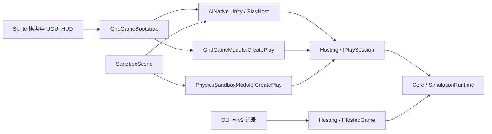
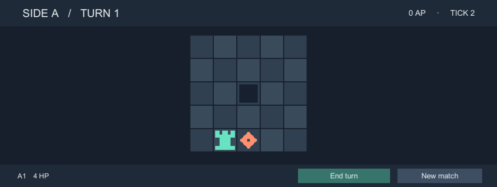

# Unity Play 宿主

两个示例复用 `AiNative.Unity`，各自维护场景、包清单、配置和插件。GridGame 在玩家操作时手动推进。PhysicsSandbox 在 Windows x64 Editor 中按 60 Hz 推进，由 Jolt 更新刚体。下文保留 GridGame 的复现步骤与原始证据。沙盒的暂停输入、读档首帧与 CLI 续跑另有完整记录。[PhysicsSandbox 实施与验收](phase-3-physics-sandbox-unity-plan.md)



**接口。** `IPlaySession<TCommand,TObservation>` 提供 Timing、Submit、CaptureObservation、AdvanceTick、Dispose。游戏模块显式创建实现此接口和 IHostedGame 的同一个对象。JSON 提交先解码再调用强类型 Submit。推进共用 Core 的一次 Advance，协议入口额外编码 TickResult。日常画面使用类型化观察。证据模式才捕获完整状态并编码结果。

**所有权。** 场景组件创建候选会话，公共 PlayHost 接管其生命周期，从初始观察建立顺序队列或实时缓冲。候选初始化成功后才发布并释放旧对局；构造失败释放候选。停用、场景卸载、退出时解除输入绑定、使帧失效并释放。每局独立，没有跨 Play 静态服务。主线程串行调用，只有宿主推进。

**手动时序。** 选中单位 → 更新本地选中态。点目标 → 提交强类型命令 → 请求一次手动 Tick → Core 消费待处理命令 → 宿主入队不可变结果 → 后续渲染帧播放移动或受击 → 完成该帧。显式空步也推进，动画和 UI 查询都不推进。

**固定时序。** `PumpFrame` 将本帧游戏时间传给 `PlayHost.Pump`。每帧最多推进四步，结余留到下一帧。PhysicsSandbox 在游戏内暂停时仍接收输入，时钟保留已有积压。恢复后的下一步按提交顺序消费输入。验收模式通过 `Pump` 的单步回调记录每个实际完成的 Tick。实时缓冲向表现层交付相邻观察和独立的事件批次。

**表现与证据。** 正交相机把屏幕坐标映射为格子，HUD 射线优先。棋盘、单位和输入映射由 GridGame 维护。实际场景在连续 Play 帧中提交、推进与记录，快慢两局均比较 CLI 的 16 个 v2 检查点。截图指定已呈现 Tick。GridGame 本轮以测试会话验证固定时钟。真实 Jolt 场景的独立验收见[PhysicsSandbox 记录](phase-3-physics-sandbox-unity-plan.md)。Player 与 IL2CPP 仍待验证。

验收记录每次操作和表现完成时的 Time.frameCount，核对操作跨帧。60 Hz 一次收到十步时长时依次推进 4、4、2 步，中间暂停不消耗积压。候选捕获失败要释放候选一次并允许旧局继续运行；替换成功后旧回调必须失效。prepare 将公共包内嵌到独立工程。

## 游戏如何接入

1. 在自己的 Unity 工程创建具体的 `PlaySceneHost<TCommand,TObservation>` 组件。基类持有每实例的 `PlayHost`，在启用时调用 `ConnectScene`，停用时调用 `DisconnectScene` 并释放对局。游戏在这两个方法中对称绑定与解除场景输入。
2. 在 `ConnectScene` 中显式创建模块，校验配置，通过 `Host.Replace` 的工厂交付新会话。GridGame 在发布候选前建立隐藏的 Sprite 棋盘。当前示例最多显示 4096 格，该限制仅作用于场景表现。如果释放旧会话自身抛错，宿主清理候选并进入故障状态；重建成功后才可再次推进。
3. 每帧依次调用 `SampleInput`、宿主的 `Pump` 和 `PresentFrame`。手动游戏用 `Host.Submit` 排队、`Host.AdvanceManual` 显式推进，从 `Host.Sequential` 消费结果。固定频率游戏只提交输入，基类按 `Timing` 推进，从 `Host.Realtime` 获取前后观察与独立事件。通过 `Host.Interpolation` 取得插值进度。
4. 包的源位于 [packages/com.ainative.unity](../packages/com.ainative.unity)。`prepare` 为示例生成内嵌包和运行时 DLL，包更新时同步移除已删除的文件。准备完成的工程可以复制到仓库外运行。示例自己的场景、HUD、业务命令及点击映射都留在工程中。

## 试玩与复现

```sh
python scripts/unity_grid.py prepare
unity open examples/unity/GridGame
```

双击 [GridGame.unity](../examples/unity/GridGame/Assets/Scenes/GridGame.unity) 并按 Play。选中左下方棋子、向右走一格、点击敌人攻击。HUD 展示行动方、回合、行动点、Tick 和选中单位生命。

使用 `python scripts/unity_grid.py verify --output TestResults/grid-play` 验收。脚本复制准备好的工程，在临时副本中分别设置 Domain Reload，运行带图形输出的 Unity Test Runner，保存 Game 视图截图、XML、Editor 日志、实际操作与呈现帧号、快慢两局的 v2 回放及 CLI 比较结果。额外一次测试在同一进程进出 Play 两次，检查对局释放。随后对比独立 CLI 记录，并注入单字段差异验证首个分歧定位。

## GridGame 本地验收记录

Windows x64、Unity 6000.3.23f1。Domain Reload 开、关各通过 7 项 PlayMode 测试，另通过 1 项同进程两次进出 Play 的测试。快慢表现与两种重载设置组成的四组比较均匹配初始检查点及 15 个操作检查点。种子 42 下共 8 个 Tick，6 次接受、1 次拒绝，A 方获胜。负对照定位到 Tick 2 的 `$.result.inputs[0].error`。[机器摘要与真实帧号](evidence/phase-3/grid-play/summary.json)

- 开启重载的 [即时表现](evidence/phase-3/grid-play/reload-on-fast.replay.json) 和 [延迟表现](evidence/phase-3/grid-play/reload-on-slow.replay.json)，关闭重载的 [即时表现](evidence/phase-3/grid-play/reload-off-fast.replay.json) 和 [延迟表现](evidence/phase-3/grid-play/reload-off-slow.replay.json)，均可直接和 [CLI 回放](evidence/phase-3/grid-play/cli.replay.json) 比较。
- 实际 Game 视图检验了棋盘输入、HUD 对合法移动的遮挡、Sprite 移动插值、命中闪烁、终局和重开。下图来自交互测试的 Tick 2，依次执行了移动和攻击；协议固定向量另外验证同 Tick 的多输入。
- 固定步长测试验证零步、单步、按 4+4+2 消费积压、暂停和输入顺序。候选创建、初始观察、场景表现准备以及旧会话释放均有失败用例。无头回归通过 239 项 .NET 测试、108 次 CLI 进程验收及原生损坏探针。本次 Play 验收为本地运行。


