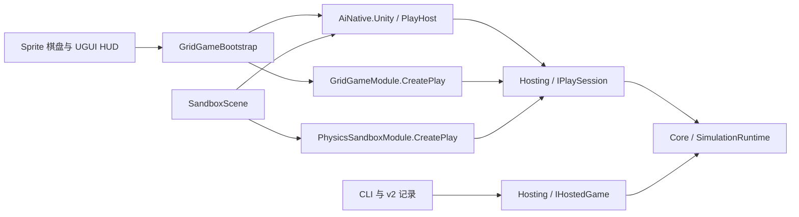
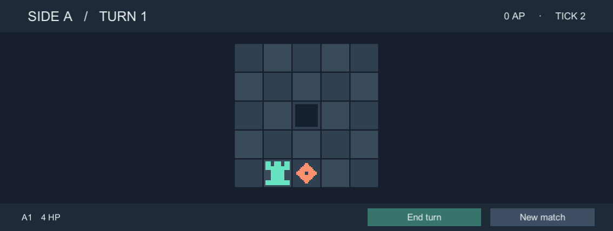

# Unity Play 宿主

GridGame HUD 已迁移到 UnityCore UI，当前装配与结果见[UI 接入验收](#gridgame-ui-模块接入2026-11-17)。下文早期场景 HUD 描述与截图保留历史含义。

当前示例已迁移到 URP 17.3.0 的 3D Forward；新增说明与本轮验收见 [资源增强与 URP 示例](assets-enhancement-urp.md)。下文旧截图和测试归档保留历史含义。本轮 GridGame 已重跑双 Domain Reload、颜色像素、快慢表现及四组 CLI 轨迹比较，不扩大到 Player／IL2CPP。

两个示例复用 `AiNative.Unity`，各自维护场景、包清单、配置和插件。GridGame 在玩家操作时手动推进。PhysicsSandbox 在 Windows x64 Editor 中按 60 Hz 推进，由 Jolt 更新刚体。下文保留 GridGame 的复现步骤与原始证据。沙盒的暂停输入、读档首帧与 CLI 续跑另有完整记录。[PhysicsSandbox 实施与验收](phase-3-physics-sandbox-unity-plan.md)



**接口。** `IPlaySession<TCommand,TObservation>` 提供 Timing、Submit、CaptureObservation、AdvanceTick、Dispose。游戏模块显式创建实现此接口和 IHostedGame 的同一个对象。JSON 提交先解码再调用强类型 Submit。推进共用 Core 的一次 Advance，协议入口额外编码 TickResult。日常画面使用类型化观察。证据模式才捕获完整状态并编码结果。

**所有权。** 场景组件创建候选会话，公共 PlayHost 接管其生命周期，从初始观察建立顺序队列或实时缓冲。候选初始化成功后才发布并释放旧对局；构造失败释放候选。停用、场景卸载、退出时解除输入绑定、使帧失效并释放。每局独立，没有跨 Play 静态服务。主线程串行调用，只有宿主推进。

**手动时序。** 选中单位 → 更新本地选中态。点目标 → 提交强类型命令 → 请求一次手动 Tick → Core 消费待处理命令 → 宿主入队不可变结果 → 后续渲染帧播放移动或受击 → 完成该帧。显式空步也推进，动画和 UI 查询都不推进。

**固定时序。** `PumpFrame` 将本帧游戏时间传给 `PlayHost.Pump`。每帧最多推进四步，结余留到下一帧。PhysicsSandbox 在游戏内暂停时仍接收输入，时钟保留已有积压。恢复后的下一步按提交顺序消费输入。验收模式通过 `Pump` 的单步回调记录每个实际完成的 Tick。实时缓冲向表现层交付相邻观察和独立的事件批次。

**表现与证据。** 正交相机把屏幕坐标映射为格子，HUD 射线优先。棋盘、单位和输入映射由 GridGame 维护。实际场景在连续 Play 帧中提交、推进与记录，快慢两局均比较 CLI 的 16 个 v2 检查点。截图指定已呈现 Tick。GridGame 本轮以测试会话验证固定时钟。真实 Jolt 场景的独立验收见[PhysicsSandbox 记录](phase-3-physics-sandbox-unity-plan.md)。Player 与 IL2CPP 仍待验证。

验收记录每次操作和表现完成时的 Time.frameCount，核对操作跨帧。60 Hz 一次收到十步时长时依次推进 4、4、2 步，中间暂停不消耗积压。候选捕获失败要释放候选一次并允许旧局继续运行；替换成功后旧回调必须失效。开发工程通过本地 UPM 引用直接编译仓库公共包源码。

## 游戏如何接入

1. 在自己的 Unity 工程创建具体的 `PlaySceneHost<TCommand,TObservation>` 组件。基类持有每实例的 `PlayHost`，在启用时调用 `ConnectScene`，停用时调用 `DisconnectScene` 并释放对局。游戏在这两个方法中对称绑定与解除场景输入。
2. 在 `ConnectScene` 中显式创建模块，校验配置，通过 `Host.Replace` 的工厂交付新会话。GridGame 在发布候选前建立隐藏的 Sprite 棋盘。当前示例最多显示 4096 格，该限制仅作用于场景表现。如果释放旧会话自身抛错，宿主清理候选并进入故障状态；重建成功后才可再次推进。
3. 每帧依次调用 `SampleInput`、宿主的 `Pump` 和 `PresentFrame`。手动游戏用 `Host.Submit` 排队、`Host.AdvanceManual` 显式推进，从 `Host.Sequential` 消费结果。固定频率游戏只提交输入，基类按 `Timing` 推进，从 `Host.Realtime` 获取前后观察与独立事件。通过 `Host.Interpolation` 取得插值进度。
4. 包的源位于 [packages/com.ainative.unity](../packages/com.ainative.unity)。manifest 通过 `file:../../../../packages/com.ainative.unity` 直接引用源码；`prepare` 只更新运行时 DLL 和数据。验收使用 `copy_verification_project` 在临时目录保留 `examples/unity/<Game>` 与 `packages/` 的相对结构，复制包源码形成隔离快照；不能仅复制示例工程三个目录后丢掉包目录。示例自己的场景、HUD、业务命令及点击映射都留在工程中。

## 试玩与复现

```sh
python scripts/unity_grid.py prepare
unity run examples/unity/GridGame -- -executeMethod AiNative.Examples.GridGame.Play.Editor.GridUiBuilder.BuildContent
unity open examples/unity/GridGame
```

双击 [GridGame.unity](../examples/unity/GridGame/Assets/Scenes/GridGame.unity) 并按 Play。选中左下方棋子、向右走一格、点击敌人攻击。HUD 展示行动方、回合、行动点、Tick 和选中单位生命。

使用 `python scripts/unity_grid.py verify --output TestResults/grid-play` 验收。脚本复制准备好的工程，在临时副本中分别设置 Domain Reload，运行带图形输出的 Unity Test Runner，保存 Game 视图截图、XML、Editor 日志、实际操作与呈现帧号、快慢两局的 v2 回放及 CLI 比较结果。额外一次测试在同一进程进出 Play 两次，检查对局释放。随后对比独立 CLI 记录，并注入单字段差异验证首个分歧定位。

## GridGame 本地验收记录

Windows x64、Unity 6000.3.23f1。Domain Reload 开、关各通过 7 项 PlayMode 测试，另通过 1 项同进程两次进出 Play 的测试。快慢表现与两种重载设置组成的四组比较均匹配初始检查点及 15 个操作检查点。种子 42 下共 8 个 Tick，6 次接受、1 次拒绝，A 方获胜。负对照定位到 Tick 2 的 `$.result.inputs[0].error`。[机器摘要与真实帧号](evidence/phase-3/grid-play/summary.json)

- 开启重载的 [即时表现](evidence/phase-3/grid-play/reload-on-fast.replay.json) 和 [延迟表现](evidence/phase-3/grid-play/reload-on-slow.replay.json)，关闭重载的 [即时表现](evidence/phase-3/grid-play/reload-off-fast.replay.json) 和 [延迟表现](evidence/phase-3/grid-play/reload-off-slow.replay.json)，均可直接和 [CLI 回放](evidence/phase-3/grid-play/cli.replay.json) 比较。
- 实际 Game 视图检验了棋盘输入、HUD 对合法移动的遮挡、Sprite 移动插值、命中闪烁、终局和重开。下图来自交互测试的 Tick 2，依次执行了移动和攻击；协议固定向量另外验证同 Tick 的多输入。
- 固定步长测试验证零步、单步、按 4+4+2 消费积压、暂停和输入顺序。候选创建、初始观察、场景表现准备以及旧会话释放均有失败用例。无头回归通过 239 项 .NET 测试、108 次 CLI 进程验收及原生损坏探针。本次 Play 验收为本地运行。



## GridGame UI 模块接入（2026-11-17）

场景内直接绑定的 GridHud 改为 UIView Prefab，由 UIModule 的 Hud 角色与 Assets 真实 SBP Bundle 加载。GridUiApplication 在明确的场景装配入口创建一次并跨场景保存，拥有 Core、Assets、UIModule 和 EventSystem，没有新增静态单例。GridHudPresenter 管理按钮和展示订阅，GridHudModel 仅保存展示观察与可撤销命令，不持有 GridHost。原 PlayHost 和 GridGameBootstrap 仍负责玩法提交、推进与释放，规则包及公共 UI/Core/Assets 包未改动。

每次启用创建新展示模型；停用先同步撤销命令、取消加载，再串行等待打开收尾和 Clear。新场景等待旧清理完成，旧句柄、旧按钮与迟到加载不能操作新对局。重开可保留 HUD，因为 Presenter 不持有被替换的对局。就绪通知独立于 Draw，初次配置失败时仍可通过 New match 重试。参考分辨率保持900×650，原有信息和按钮行为不变。[接入与复现说明](../examples/unity/GridGame/README.md#ui-模块接入)

Windows Editor、Unity 6000.3.23f1、Unity CLI 1.0.1、URP 17.3.0 Forward，在仓库外副本重新构建部署真实SBP内容后执行：

| 检查 | 实际结果 |
| --- | --- |
| Domain Reload 开启 | 11/11 PlayMode通过 |
| Domain Reload 关闭 | 11/11 PlayMode通过 |
| 同进程连续进出Play两次 | 1/1 EditMode通过 |
| CLI与Unity快/慢轨迹 | 四组各16检查点一致；8 Tick、6接受、1拒绝、A获胜 |
| 单字段负对照 | 定位Tick 2的输入错误字段差异 |
| Game视图 | 两张1240×407 PNG完整解码、像素检查通过并逐张查看，内容相同 |

共23次执行通过，0失败、0跳过。新增四项覆盖真实Bundle所有权与排空、加载中停用后同帧重连、场景重载与旧句柄，以及无观察数据时的重开重试。原有移动、攻击、终局、重开、HUD射线阻挡、快慢表现、候选失败和时钟测试保留。Clear后窗口、Bundle、资源、挂起操作和清理错误归零，应用仍运行，保留application与新UI generation两个空scope。

独立审查发现并修复了“就绪不通知Presenter导致初始对局失败后按钮无法重试”的问题。初次编译的Core命名空间歧义和Editor程序集引用缺失，以及首次隔离构建的两个Label节点重名失败，均保留原始日志，不计入23次通过。

有效原始输出为 `TestResults/grid-ui-second-20261117`，副本路径记录在workspace.txt。184份源码、程序集定义、资源和包清单与工作区逐文件匹配；另保留SBP生成预过滤字段后的Forward.asset，工作区恢复原管线文件。Domain Reload配置、URP自动输入轴等生成设置保留在验证副本范围。日志有Unity许可、URP导入依赖和Mono退出提示，测试日志无C#编译错误或未预期的产品异常，不宣称所有Editor日志完全无警告。

证据见[摘要](evidence/grid-ui-20261117/summary.json)、[归档](evidence/grid-ui-20261117/grid-ui-evidence.zip)、[独立复核](evidence/grid-ui-20261117/review.json)和[HUD截图](evidence/grid-ui-20261117/game-tick-2.png)。本轮使用EventSystem射线/事件与测试调用，未验收新的OS原生输入、GridGame Player/IL2CPP、设备安全区、性能或远端Unity CI。

## Windows Player 人工验收（2026-11-18）

用户在 Windows IL2CPP Player 中确认移动、攻击和回合切换正常，点击 **New Match** 可重新开局。[验收记录](phase-4-delivery.md#windows-人工验收)
